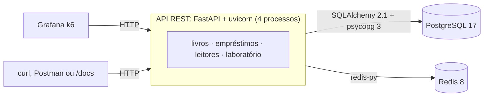
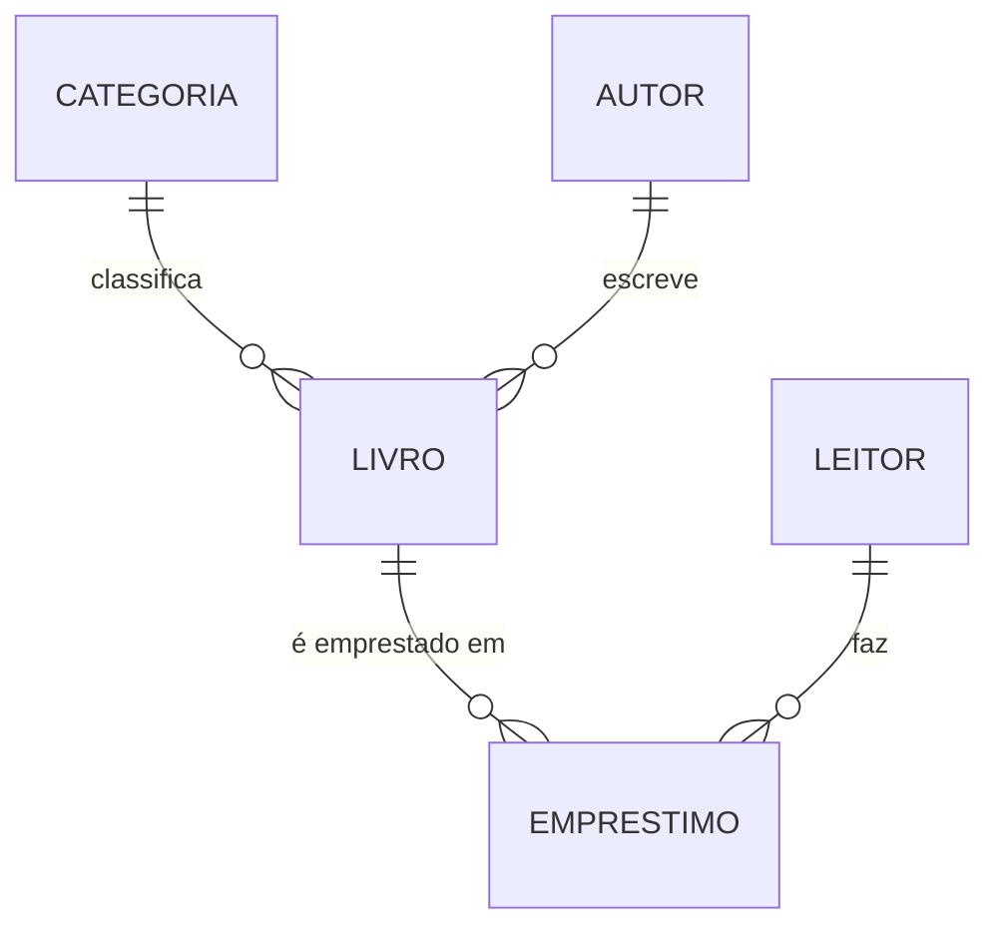

# Biblioteca: otimização de Web Services com cache, consultas ao banco e testes de carga

Trabalho Prático A2 de Análise e Otimização de Sistemas (Universidade Veiga de Almeida).

| Integrante | Matrícula |
|---|---|
| Giovanni Cardoso Avallone Belo | 1230104729 |
| Luana Cristina de Azevedo Celestino | 1230206514 |
| Marcos Felipe Ferreira Pires | 1230110993 |
| Pedro Henrique Graciliano Taka | 1230119578 |

Uma API REST de biblioteca (livros, autores, categorias, leitores e empréstimos) em que a mesma
consulta existe em versões diferentes — sem e com cache; LAZY, EAGER e otimizada; sem e com
índice — para que cada técnica seja comparada por medição. Este README é o relatório técnico
pedido na seção 7.2 do enunciado; as instruções de execução estão em [Como executar](#como-executar).

## Sumário

1. [Introdução](#1-introdução)
2. [Arquitetura e tecnologias](#2-arquitetura-e-tecnologias)
3. [Implementação de cache](#3-implementação-de-cache)
4. [Otimização das consultas](#4-otimização-das-consultas)
5. [Testes de desempenho](#5-testes-de-desempenho)
6. [Discussão](#6-discussão)
7. [Conclusão](#7-conclusão)

## 1. Introdução

A aplicação é a API de uma biblioteca: catálogo de livros (com autor e categoria), leitores e
empréstimos. Não há interface gráfica; tudo é acessado por HTTP, e a documentação interativa em
`/docs` permite chamar cada rota pelo navegador.

O objetivo do trabalho é aplicar três técnicas de otimização e provar o efeito de cada uma com
medições, seguindo a ideia central do enunciado: identificar o problema, implementar uma
alternativa, medir, comparar e justificar. Por isso cada operação estudada existe em mais de uma
versão, todas devolvendo exatamente o mesmo JSON, e toda resposta da API informa quantos comandos
SQL foram executados e quanto tempo se gastou no banco.

| Item do enunciado | Problema estudado | Alternativas comparadas |
|---|---|---|
| 1. Cache | a ficha do livro custa três consultas e é a leitura mais frequente | sem cache; cache Redis com TTL e invalidação |
| 2. Consultas | listar empréstimos com o livro e o leitor de cada um gera o problema N+1 | LAZY, EAGER, JOIN explícito, projeção e SQL nativo |
| 2. Índices | o histórico de um leitor percorre a tabela inteira de empréstimos | sem índice; índice simples, composto e parcial |
| 3. Testes de desempenho | os ganhos se mantêm sob carga? | todas as versões acima com 10, 50, 100 e 200 usuários virtuais (Grafana k6) |

## 2. Arquitetura e tecnologias



Tudo roda em contêineres (Docker Compose): banco, cache, API e o k6, que fica na mesma rede da API.

| Camada | Tecnologia | Por que foi escolhida |
|---|---|---|
| Web Services | Python 3.14, FastAPI 0.163, uvicorn com 4 processos | API REST com validação e documentação interativa geradas a partir do código |
| Persistência | SQLAlchemy 2.1 (ORM) e psycopg 3.3 | o equivalente em Python do JPA/Hibernate que o enunciado recomenda (2.1): LAZY e EAGER declarados no relacionamento, além de JOIN explícito, busca em lote, projeções e SQL nativo |
| Banco de dados | PostgreSQL 17 | `EXPLAIN ANALYZE`, estatísticas por comando (`pg_stat_statements`) e índices parciais |
| Cache | Redis 8.10 | compartilhado pelos processos da API e com TTL próprio (seção 3.3) |
| Testes de carga | Grafana k6 2.3 | seção 5.1 |

Como cada processo Python executa código em um núcleo por vez, a API roda com 4 processos
(`--workers 4`), cada um com até 20 conexões com o banco.

### Entidades e volume de dados



| Tabela | Registros | Conteúdo |
|---|---:|---|
| `categoria` | 20 | gêneros (romance, ficção científica, história...) |
| `autor` | 5.000 | nome e nacionalidade |
| `livro` | 20.000 | título, ISBN, editora, ano, páginas, sinopse, exemplares (total e disponíveis) |
| `leitor` | 10.000 | nome, e-mail e data de cadastro |
| `emprestimo` (entidade principal) | 300.000 | livro, leitor, data do empréstimo, prazo e devolução |

Os dados são gerados por [`banco/02-dados.sql`](banco/02-dados.sql) na primeira subida do banco,
em cerca de 6 segundos, com semente fixa: toda instalação tem os mesmos registros, com as datas
contadas a partir do dia da criação. São três anos de empréstimos; alguns livros e leitores
concentram mais empréstimos que outros (cada leitor tem de 10 a 243, com mediana de 28), e os
empréstimos dos últimos dias ainda estão em aberto (3.722, dos quais 901 atrasados). O banco ocupa
51 MB e cabe inteiro na memória do PostgreSQL (`shared_buffers` de 256 MB).

### Web Services

| Rota | O que faz |
|---|---|
| `GET /api/livros/{id}/sem-cache` | ficha do livro, sempre montada a partir do banco (3 consultas) |
| `GET /api/livros/{id}/com-cache` | a mesma ficha, do Redis quando possível (cabeçalho `X-Cache: HIT` ou `MISS`) |
| `PUT /api/livros/{id}` | altera dados de catálogo e invalida a ficha no cache |
| `GET /api/livros/{id}/disponibilidade` | exemplares disponíveis, sempre do banco |
| `GET /api/emprestimos/{estratégia}?desde_id=&quantidade=` | página de empréstimos com livro e leitor, em sete estratégias de carregamento (seção 4) |
| `GET /api/emprestimos/lazy/resumo` e `/eager/resumo` | a mesma página, sem usar livro e leitor |
| `GET /api/emprestimos/atrasados` | empréstimos atrasados, dos mais antigos aos mais recentes (busca por intervalo) |
| `POST /api/emprestimos` e `POST /api/emprestimos/{id}/devolucao` | registram empréstimo e devolução, com bloqueio da linha do livro |
| `GET /api/leitores/{id}/emprestimos` | histórico de empréstimos do leitor (consulta do experimento de índices) |
| `/api/laboratorio/...` | preparam e observam os experimentos: esvaziar o cache, criar e remover índices, `EXPLAIN ANALYZE`, SQL executado por uma operação, contadores do banco |

**Instrumentação.** Um ouvinte de eventos do SQLAlchemy (`before_cursor_execute` e
`after_cursor_execute`) conta cada comando SQL e o tempo dele, e um middleware escreve em toda
resposta os cabeçalhos `X-Consultas-SQL` e `Server-Timing` (tempo no banco e tempo total no
servidor, em ms). As rotas `/api/laboratorio/sql/...` executam uma operação e devolvem cada comando
SQL, na ordem, com as linhas e os bytes que voltaram do banco. É daí que saem os números das
seções 3 e 4; os roteiros que os produzem estão em [`experimentos/`](experimentos).

## 3. Implementação de cache

### 3.1 O que vai para o cache

A operação escolhida é a ficha do livro: dados de catálogo, autor, categoria, total de
empréstimos e outros livros do mesmo autor. Montá-la custa três consultas (uma com JOIN entre
livro, autor e categoria, uma contagem na tabela de empréstimos e uma busca por autor), e ela é a
leitura mais comum de um catálogo. A decisão sobre cada parte da ficha seguiu os critérios da 3.1
do enunciado:

| Dado | Frequência de acesso | Volatilidade | Se ficar desatualizado | Decisão |
|---|---|---|---|---|
| Título, autor, categoria, sinopse, editora | alta: toda consulta ao catálogo | muito baixa: só muda quando a biblioteca corrige o cadastro | um título ou sinopse antiga por alguns minutos | cache com TTL longo e invalidação na alteração |
| Total de empréstimos e data do último | alta (faz parte da ficha) | média: muda a cada empréstimo | um indicador de popularidade atrasado em minutos, sem prejuízo | vai junto com a ficha; o atraso fica limitado pelo TTL |
| Exemplares disponíveis | alta | alta: muda a cada empréstimo e devolução | o leitor vai à estante e não encontra o livro | **fora do cache**: rota própria, sempre lida do banco |

### 3.2 As duas versões

`GET /api/livros/{id}/sem-cache` monta a ficha a partir do banco em toda requisição.
`GET /api/livros/{id}/com-cache` segue a estratégia *cache-aside* ([`api/app/rotas/livros.py`](api/app/rotas/livros.py)):

```python
def ficha_com_cache(livro_id: IdDoLivro):
    chave = cache.chave_do_livro(livro_id)           # "livro:42"
    guardada = cache.ler(chave)
    if guardada is not None:                          # acerto: nenhuma consulta ao banco
        return RespostaJSON(guardada, headers={"X-Cache": "HIT"})

    corpo = para_json(_ficha_do_banco(livro_id))      # falha: três consultas
    cache.gravar(chave, corpo)                        # SET livro:42 <json> EX 600
    return RespostaJSON(corpo, headers={"X-Cache": "MISS"})
```

O cache guarda o JSON já pronto. As duas versões usam a mesma função para montar a ficha, e a
resposta só difere no cabeçalho `X-Cache`. O campo `gerada_em` mostra quando a ficha foi montada:
se ele se repete, a resposta veio do cache.

### 3.3 Tecnologia: Redis

O Redis é um armazenamento chave-valor em memória que roda como um serviço à parte. Ele foi
escolhido, e não um cache dentro da aplicação (como o `functools.lru_cache` ou o `cachetools`
do Python), porque a API roda em 4 processos. Um cache interno teria quatro cópias
independentes; uma alteração invalidaria só a cópia do processo que a recebeu, e os outros três
continuariam servindo a ficha antiga. No Redis há uma cópia só, e apagar a chave vale para todos os
processos (e para quantos servidores houver). Ele também tem TTL nativo (`SET ... EX`) e, com
`maxmemory 256mb` e `allkeys-lru`, descarta as chaves menos usadas se a memória acabar; as 20.000
fichas ocupam 25 MB (cerca de 1,3 KB cada). O custo é uma ida e volta pela rede a cada leitura e mais um
serviço para operar.

### 3.4 Tempo de vida e invalidação

- **TTL de 600 segundos** (`CACHE_TTL_SEGUNDOS`). Como toda alteração feita pela API já apaga a
  ficha, o TTL só limita dois atrasos: o do total de empréstimos, que nenhuma rota invalida, e o de
  alterações feitas por fora da API (uma importação, um comando SQL direto no banco). Dez minutos
  são aceitáveis para dados de catálogo e mantêm a ficha no cache durante uma sessão inteira de
  navegação. O efeito de outros valores de TTL foi medido na seção 5.
- **Invalidação**: `PUT /api/livros/{id}` altera o livro e, depois do *commit*, apaga a chave.
  Apagar antes do *commit* abriria uma janela em que uma leitura simultânea guardaria de novo a
  versão antiga.

```python
    with Sessao.begin() as sessao:                    # transação: commit no fim do bloco
        livro = sessao.get(Livro, livro_id)
        for nome, valor in campos.items():
            setattr(livro, nome, valor)
        livro.atualizado_em = datetime.now()

    invalidou = cache.invalidar(cache.chave_do_livro(livro_id))   # DEL livro:42
```

**Experimento obrigatório** ([`experimentos/cache.py`](experimentos/cache.py)), com o TTL
reduzido para 20 s para a espera do passo 5 caber na demonstração:

| Passo | Operação | X-Cache | Consultas SQL | Tempo no servidor | Título devolvido | Ficha gerada às |
|---|---|---|---:|---:|---|---|
| 1 | GET com cache, cache vazio | MISS | 3 | 2,97 ms | A Biblioteca Eterna dos Esquecidos | 23:33:02.697 |
| 2 | GET com cache de novo | HIT | 0 | 0,37 ms | A Biblioteca Eterna dos Esquecidos | 23:33:02.697 |
| 3 | `PUT /api/livros/42` com título novo | – | 5 | 5,26 ms | (resposta: `X-Cache-Invalidado: sim`) | – |
| 4a | GET com cache depois do PUT | MISS | 3 | 2,72 ms | ... dos Esquecidos (edição revista) | 23:33:02.710 |
| 4b | GET com cache de novo | HIT | 0 | 0,36 ms | ... dos Esquecidos (edição revista) | 23:33:02.710 |
| 5a | `UPDATE` direto no banco, por fora da API | – | – | – | – | – |
| 5b | GET com cache | HIT | 0 | 0,77 ms | ... (edição revista), **o título antigo** | 23:33:02.710 |
| 5c | GET com cache depois de o TTL acabar | MISS | 3 | 4,54 ms | ... (edição revista) [alterado direto no banco] | 23:33:24.422 |

O passo 2 mostra o reaproveitamento (mesma `gerada_em`, nenhuma consulta). Os passos 3 e 4 mostram
a invalidação: a primeira leitura depois da alteração já traz o título novo. O passo 5 mostra o
limite dessa estratégia: uma alteração feita por fora da API não avisa o cache, e a ficha antiga
continua sendo servida (5b) até expirar (5c). **Riscos**: durante esse intervalo o usuário vê um
dado que não existe mais; se o dado em cache fosse usado para uma decisão (por exemplo, permitir um
empréstimo), o erro seria grave. Por isso a disponibilidade ficou fora do cache e o registro de
empréstimo confere o estoque no banco, com a linha do livro bloqueada (`SELECT ... FOR UPDATE`).
Resta ainda uma janela rara de corrida: uma leitura que buscou a versão antiga antes do *commit*
pode gravá-la no cache logo depois da invalidação; o TTL também limita esse caso.

### 3.5 Análise de desempenho do cache

Uma requisição por vez, 300 livros sorteados ([`experimentos/resultados/cache.md`](experimentos/resultados/cache.md)):

| Situação | Consultas SQL por requisição | Tempo no servidor (mediana) | p95 | Tempo total no cliente (mediana) |
|---|---:|---:|---:|---:|
| sem cache | 3 | 2,23 ms | 2,44 ms | 2,72 ms |
| com cache, falha (ficha ainda não guardada) | 3 | 2,53 ms | 2,86 ms | 3,00 ms |
| com cache, acerto | 0 | 0,37 ms | 0,46 ms | 0,85 ms |

O acerto é 6 vezes mais rápido no servidor e não consulta o banco. A falha é 13% mais lenta que
não ter cache: ela paga as três consultas mais a leitura e a gravação no Redis. O comportamento sob
carga, o cache frio e o efeito do TTL estão na seção 5.

<!-- RESPOSTAS-3.5 -->

## 4. Otimização das consultas

### 4.1 e 4.2 LAZY e EAGER

O relacionamento estudado é Empréstimo → Livro e Empréstimo → Leitor: a listagem devolve uma
página de empréstimos com o título do livro e o nome do leitor de cada um. No SQLAlchemy, a
estratégia é declarada no relacionamento, como o `FetchType` do JPA
([`api/app/modelos.py`](api/app/modelos.py)). A tabela é mapeada duas vezes para as duas versões
existirem lado a lado:

```python
class Emprestimo(Base):                     # LAZY: busca o livro só quando o código o acessa
    __tablename__ = "emprestimo"
    ...
    livro: Mapped[Livro] = relationship(lazy="select")
    leitor: Mapped[Leitor] = relationship(lazy="select")


class EmprestimoEager(Base):                # EAGER: a mesma tabela, com o livro e o leitor
    __table__ = Emprestimo.__table__        # trazidos na mesma consulta, com JOIN
    livro: Mapped[Livro] = relationship(lazy="joined", viewonly=True)
    leitor: Mapped[Leitor] = relationship(lazy="joined", viewonly=True)
```

A rota é a mesma nas duas versões; só muda a classe consultada. O SQL abaixo foi registrado pela
rota de laboratório para uma página de 3 empréstimos (todos os comandos estão em
[`experimentos/resultados/sql/`](experimentos/resultados/sql)):

```sql
-- LAZY: 7 comandos. A página vem primeiro; cada livro e cada leitor é buscado no momento em que
-- a resposta é montada (e.livro.titulo, e.leitor.nome), intercalados, um empréstimo por vez.
SELECT emprestimo.id, emprestimo.livro_id, emprestimo.leitor_id, ... FROM emprestimo
WHERE emprestimo.id >= 150000 ORDER BY emprestimo.id LIMIT 3;
SELECT livro.id, livro.titulo, livro.isbn, ..., livro.sinopse, ... FROM livro WHERE livro.id = 13400;
SELECT leitor.id, leitor.nome, leitor.email, leitor.cadastrado_em FROM leitor WHERE leitor.id = 8581;
SELECT ... FROM livro WHERE livro.id = 3487;
SELECT ... FROM leitor WHERE leitor.id = 7635;
SELECT ... FROM livro WHERE livro.id = 10307;
SELECT ... FROM leitor WHERE leitor.id = 53;

-- EAGER: 1 comando, 22 colunas (todas as de empréstimo, livro e leitor)
SELECT emprestimo.id, ..., livro_1.id AS id_1, livro_1.titulo, ..., livro_1.sinopse, ...,
       leitor_1.id AS id_2, leitor_1.nome, leitor_1.email, leitor_1.cadastrado_em
FROM emprestimo
LEFT OUTER JOIN livro AS livro_1 ON livro_1.id = emprestimo.livro_id
LEFT OUTER JOIN leitor AS leitor_1 ON leitor_1.id = emprestimo.leitor_id
WHERE emprestimo.id >= 150000 ORDER BY emprestimo.id LIMIT 3;
```

O LAZY tem o problema N+1: 1 consulta para a página e mais 2 por empréstimo (menos os livros e
leitores repetidos, que o SQLAlchemy reaproveita da sessão). No SQLAlchemy, o EAGER declarado com
`lazy="joined"` resolveu tudo numa consulta, mas **EAGER não garante uma consulta só** (4.2 do
enunciado): a mesma intenção, "carregar antes", com outra forma de busca, deu resultados bem
diferentes:

- `selectinload` (EAGER em consultas separadas): 1 consulta para a página e 1 para todos os livros
  (`WHERE id IN (...)`), mais 1 para os leitores. Com 1.000 empréstimos foram 5 consultas, porque
  o SQLAlchemy divide a lista do `IN` em lotes de 500.
- `immediateload` (EAGER que busca cada objeto logo após carregar a página): o mesmo N+1 do LAZY,
  só que antes de a resposta ser montada. É o comportamento do EAGER do Hibernate numa consulta
  JPQL sem `JOIN FETCH`.

### 4.3 Comparação com diferentes quantidades de registros

[`experimentos/carregamento.py`](experimentos/carregamento.py) mediu cada estratégia com páginas de
10 a 1.000 empréstimos, uma requisição por vez (mediana de 5 a 21 repetições):

| Consultas SQL por requisição | 10 | 50 | 100 | 500 | 1.000 |
|---|---:|---:|---:|---:|---:|
| LAZY | 21 | 101 | 200 | 983 | 1.922 |
| EAGER (`lazy="joined"`) | 1 | 1 | 1 | 1 | 1 |
| EAGER com `selectinload` | 3 | 3 | 3 | 3 | 5 |
| EAGER com `immediateload` | 21 | 101 | 200 | 983 | 1.922 |
| JOIN FETCH (`joinedload`) | 1 | 1 | 1 | 1 | 1 |
| otimizada (projeção) | 1 | 1 | 1 | 1 | 1 |
| SQL nativo | 1 | 1 | 1 | 1 | 1 |

| Tempo no servidor, em ms (mediana) | 10 | 50 | 100 | 500 | 1.000 |
|---|---:|---:|---:|---:|---:|
| LAZY | 9,4 | 36,7 | 72,2 | 350,3 | 674,6 |
| EAGER (`lazy="joined"`) | 1,5 | 2,3 | 3,3 | 11,9 | 24,6 |
| EAGER com `selectinload` | 2,5 | 3,7 | 5,9 | 19,5 | 37,7 |
| EAGER com `immediateload` | 9,5 | 38,5 | 74,1 | 356,9 | 711,9 |
| JOIN FETCH (`joinedload`) | 1,5 | 2,3 | 3,3 | 12,6 | 23,5 |
| otimizada (projeção) | 1,4 | 1,6 | 1,9 | 5,0 | 8,6 |
| SQL nativo | 1,1 | 1,4 | 1,7 | 4,1 | 8,3 |

O N+1 faz o número de consultas e o tempo crescerem na proporção do tamanho da página: com 1.000
empréstimos, o LAZY fez 1.922 consultas e levou 675 ms, 27 vezes o EAGER. Cada consulta custa pouco
no banco (0,15 ms), mas são 1.922 idas e voltas, e o tempo no banco chegou a 296 ms dos 675.

**Volume de informações e dados desnecessários.** Para 1.000 empréstimos, o banco devolveu 526 KB
ao EAGER (1.000 linhas largas, com a sinopse de cada livro), 512 KB ao LAZY (2.921 linhas, em 1.922
consultas) e 108 KB à versão otimizada, para a mesma resposta de 228 KB. O custo do EAGER aparece
quando a resposta não usa os relacionamentos: nas versões "resumo", que devolvem só os dados do
empréstimo, o mapeamento EAGER continua fazendo o JOIN e trazendo todas as colunas de livro e
leitor.

| Versão "resumo" (sem livro e leitor) | Consultas | Lido do banco | Tempo no servidor |
|---|---:|---:|---:|
| LAZY, 20 empréstimos | 1 | 1,2 KB | 1,14 ms |
| EAGER, 20 empréstimos | 1 | 10,5 KB | 1,72 ms |
| LAZY, 1.000 empréstimos | 1 | 60,9 KB | 5,90 ms |
| EAGER, 1.000 empréstimos | 1 | 526,0 KB | 22,22 ms |

**Quando usar cada um.** LAZY é o padrão mais seguro: não carrega o que não é usado e funciona bem
para objetos isolados ou relacionamentos raramente acessados; o perigo é percorrer uma lista
acessando o relacionamento, que gera o N+1. EAGER compensa quando o relacionamento é usado
praticamente sempre que a entidade é lida, mas, declarado no mapeamento, ele vale para todas as
consultas, inclusive as que não precisam dos dados (as versões "resumo"). A escolha melhor é
manter o mapeamento LAZY e pedir o carregamento antecipado em cada consulta que precisa dele
(`joinedload` ou `selectinload`), como o `JOIN FETCH` do JPA. Para coleções (um-para-muitos), o
`selectinload` evita multiplicar as linhas da consulta principal, que o JOIN causaria.

### 4.4 Otimização das consultas

Partindo do LAZY original, foram implementadas três alternativas
([`api/app/rotas/emprestimos.py`](api/app/rotas/emprestimos.py)):

```python
# JOIN FETCH: o mapeamento continua LAZY, mas esta consulta pede livro e leitor com JOIN
consulta = _pagina(Emprestimo, desde_id, quantidade).options(
    joinedload(Emprestimo.livro), joinedload(Emprestimo.leitor))

# otimizada: projeção (DTO), uma consulta com JOIN que traz só as 8 colunas da resposta
consulta = (
    select(Emprestimo.id, Emprestimo.data_emprestimo, Emprestimo.data_prevista,
           Emprestimo.data_devolucao, Livro.id.label("livro_id"), Livro.titulo,
           Leitor.id.label("leitor_id"), Leitor.nome)
    .join(Livro, Livro.id == Emprestimo.livro_id)
    .join(Leitor, Leitor.id == Emprestimo.leitor_id)
    .where(Emprestimo.id >= desde_id).order_by(Emprestimo.id).limit(quantidade))

# nativa: a mesma consulta, escrita à mão
SQL_NATIVO = text("""
    SELECT e.id, e.data_emprestimo, e.data_prevista, e.data_devolucao,
           l.id AS livro_id, l.titulo, r.id AS leitor_id, r.nome
    FROM emprestimo e
    JOIN livro l ON l.id = e.livro_id
    JOIN leitor r ON r.id = e.leitor_id
    WHERE e.id >= :desde_id ORDER BY e.id LIMIT :quantidade""")
```

O `JOIN FETCH` gera o mesmo SQL do EAGER e teve o mesmo tempo, sem impor o JOIN às outras
consultas. A versão otimizada foi a mais rápida das que usam o ORM: com 1.000 empréstimos, 8,6 ms
contra 24,6 ms do EAGER e 675 ms do LAZY, porque lê 5 vezes menos dados e não cria entidades. Sob
carga, a comparação está na seção 5.

**O SQL nativo trouxe benefício real?** Pouco. Ele executa a mesma consulta da versão otimizada
(as duas leram 108 KB e gastaram praticamente o mesmo tempo no banco); a diferença, de 0,2 a
0,9 ms por requisição, é o trabalho do SQLAlchemy de montar a consulta e processar o resultado
pelo ORM a cada chamada. O ganho grande
(80 vezes, de 675 para 8,3 ms) veio de eliminar o N+1 e de buscar só as colunas usadas, e o ORM
faz as duas coisas. Em troca, o SQL nativo cobra na manutenção: é texto que o ORM não confere (um
nome de coluna errado só aparece quando a rota roda), não acompanha uma mudança no mapeamento,
exige converter as linhas à mão e depende do dialeto do banco (`LIMIT` e as conversões de tipo
mudam entre PostgreSQL, SQL Server e Oracle). Faz sentido usá-lo em consultas que o ORM não
expressa bem (funções de janela, CTEs recursivas, dicas específicas do banco), não como regra.

### 4.5 Índices (seção 5 do enunciado)

A consulta escolhida é o histórico de empréstimos de um leitor, no mesmo formato do exemplo do
enunciado (filtro por chave estrangeira, JOIN e ordenação):

```sql
SELECT e.id, e.data_emprestimo, e.data_prevista, e.data_devolucao, l.id, l.titulo
FROM emprestimo e JOIN livro l ON l.id = e.livro_id
WHERE e.leitor_id = 150
ORDER BY e.data_emprestimo DESC;
```

No estado inicial, `emprestimo(leitor_id)` não tem índice (o PostgreSQL não cria índice para chave
estrangeira). O índice proposto é `CREATE INDEX idx_emprestimo_leitor_data ON emprestimo (leitor_id, data_emprestimo DESC)`.
[`experimentos/indices.py`](experimentos/indices.py) comparou cinco situações, para o leitor 150
(58 empréstimos) e para o leitor com mais empréstimos (4322, com 243). Os planos completos estão
em [`experimentos/resultados/planos/`](experimentos/resultados/planos):

| Situação | Leitor | Operações na tabela `emprestimo` | Sort | Linhas descartadas | Execução no banco |
|---|---|---|---|---:|---:|
| 1. sem índice | 150 | Parallel Seq Scan | sim | 299.942 | 8,779 ms |
| 1. sem índice | 4322 | Parallel Seq Scan | sim | 299.756 | 9,706 ms |
| 2. índice só em `leitor_id` | 150 | Bitmap Index Scan + Bitmap Heap Scan | sim | 0 | 0,102 ms |
| 3. índice proposto | 150 | Bitmap Index Scan + Bitmap Heap Scan | sim | 0 | 0,103 ms |
| 3. índice proposto | 4322 | Bitmap Index Scan + Bitmap Heap Scan | sim | 0 | 0,462 ms |
| 4. índice proposto, `random_page_cost` = 1,1 | 150 | Index Scan, já na ordem | não | 0 | 0,075 ms |
| 5. índice proposto, `LIMIT 10` | 150 | Index Scan, já na ordem | não | 0 | 0,025 ms |

Execução no banco: mediana de 15 `EXPLAIN ANALYZE`. Trechos dos planos (`EXPLAIN (ANALYZE, BUFFERS)`):

```
-- 1. sem índice: lê a tabela inteira (2.498 páginas) e descarta quase tudo
Gather Merge  (cost=5846.56..5848.63 rows=18 width=60) (actual time=7.191..9.106 rows=58 loops=1)
  Workers Planned: 1
  Workers Launched: 1
  ->  Sort  (cost=4846.55..4846.59 rows=18 width=60) (actual time=5.396..5.398 rows=29 loops=2)
        Sort Key: emprestimo.data_emprestimo DESC
        ->  Nested Loop  (cost=0.29..4846.17 rows=18 width=60) (actual time=0.309..5.371 rows=29 loops=2)
              ->  Parallel Seq Scan on emprestimo  (cost=0.00..4703.88 rows=18 width=32) (actual time=0.294..5.268 rows=29 loops=2)
                    Filter: (leitor_id = 150)
                    Rows Removed by Filter: 149971
                    Buffers: shared hit=2498
              ->  Index Scan using livro_pkey on livro  (cost=0.29..7.90 rows=1 width=32) (actual time=0.003..0.003 rows=1 loops=58)
                    Index Cond: (id = emprestimo.livro_id)
Execution Time: 9.120 ms

-- 3. índice proposto: só as 58 linhas do leitor; o Sort continua
Sort  (cost=353.05..353.13 rows=30 width=60) (actual time=0.100..0.102 rows=58 loops=1)
  Sort Key: emprestimo.data_emprestimo DESC
  ->  Nested Loop  (cost=4.94..352.32 rows=30 width=60) (actual time=0.011..0.089 rows=58 loops=1)
        ->  Bitmap Heap Scan on emprestimo  (cost=4.66..115.17 rows=30 width=32) (actual time=0.008..0.029 rows=58 loops=1)
              Recheck Cond: (leitor_id = 150)
              Heap Blocks: exact=58
              ->  Bitmap Index Scan on idx_emprestimo_leitor_data  (cost=0.00..4.65 rows=30 width=0) (actual time=0.004..0.004 rows=58 loops=1)
                    Index Cond: (leitor_id = 150)
        ->  Index Scan using livro_pkey on livro  (cost=0.29..7.90 rows=1 width=32) (actual time=0.001..0.001 rows=1 loops=58)
              Index Cond: (id = emprestimo.livro_id)
Execution Time: 0.111 ms
```

Na API, o histórico do leitor 150 passou de 10,9 ms para 1,4 ms no servidor. Também foi medida a
busca por intervalo (os 50 empréstimos atrasados mais antigos: `data_devolucao IS NULL AND
data_prevista < hoje ORDER BY data_prevista`): sem índice, 9,1 ms com Parallel Seq Scan; com o
índice parcial `ON emprestimo (data_prevista) WHERE data_devolucao IS NULL`, de apenas 48 KB, 0,23
ms.

**O índice foi efetivamente utilizado?** Sim: a varredura completa (Seq Scan) deu lugar ao
`Bitmap Index Scan` em `idx_emprestimo_leitor_data`, e as 299.942 linhas descartadas pelo filtro
caíram para zero. Mas o banco usou o índice só para achar as linhas do leitor, não para entregá-las
em ordem: o `Sort` continuou no plano, e o índice composto teve o mesmo plano e o mesmo tempo do
índice só em `leitor_id`. O plano também mostra outro índice que já existia, `livro_pkey`, usado
no JOIN com `livro` em todas as situações (como o enunciado alerta na 5.2).

**Houve redução no tempo de execução?** Sim, de 8,8 ms para 0,10 ms no banco (cerca de 85 vezes)
e de 10,9 ms para 1,4 ms no servidor. Sob carga, o efeito está na seção 5.

**Quais fatores influenciaram o resultado?**

- *Seletividade*: o leitor 150 tem 58 dos 300.000 empréstimos (0,02%). Com tão poucas linhas, o
  índice vence com folga; para o leitor com 243 empréstimos, o tempo com índice subiu para 0,46 ms
  (cresce com as linhas do leitor), enquanto a varredura completa custa o mesmo para todos.
- *Modelo de custos do planejador*: com o padrão `random_page_cost = 4`, pensado para disco
  magnético, o PostgreSQL acha mais barato ler as 58 linhas pelo bitmap (páginas em ordem física) e
  ordená-las do que percorrer o índice já na ordem. Com 1,1, valor indicado quando os dados estão em
  memória ou SSD (o caso aqui), ele passa a usar o `Index Scan` na ordem do índice e o `Sort` some.
- *LIMIT*: pedindo só os 10 mais recentes, o índice composto é usado por inteiro: o banco lê as
  10 primeiras entradas do leitor, já ordenadas, e para (0,03 ms).
- *Correlação física*: os empréstimos de um leitor estão espalhados pela tabela, uma página para
  cada (58 linhas em 58 páginas), porque a tabela está em ordem de data e não de leitor.

**Quais podem ser os custos de manter índices adicionais?** Espaço e escrita. O índice proposto
ocupa 9,0 MB, quatro vezes o índice só em `leitor_id` (2,2 MB), que se beneficia da deduplicação
de chaves repetidas do PostgreSQL; a tabela inteira tem 20 MB. E todo `INSERT` precisa atualizar
cada índice: inserir 20.000 empréstimos (numa transação desfeita no fim, mediana de 5) levou
10,7 µs por linha sem os índices do experimento, 13,2 µs com o índice proposto (+23%) e 14,9 µs
com os três (+39%). Também há mais trabalho de `VACUUM` e mais páginas disputando a memória do banco.

| Índices extras em `emprestimo` | Tamanho dos índices | Inserir 20.000 empréstimos | Por linha |
|---|---:|---:|---:|
| nenhum (só chave primária e `livro_id`) | 8,9 MB | 214 ms | 10,7 µs |
| `(leitor_id, data_emprestimo DESC)` | 17,9 MB | 264 ms | 13,2 µs |
| os três do experimento | 20,1 MB | 299 ms | 14,9 µs |

**Criar índices em todas as colunas consultadas seria uma boa estratégia?** Não. Cada índice só
ajuda as consultas que filtram ou ordenam pelas colunas dele, na ordem certa e com seletividade
suficiente; em colunas pouco seletivas (como `data_devolucao IS NULL` sem ser parcial, ou uma
categoria entre 20) o planejador prefere a varredura completa e o índice só ocupa espaço. E todos
eles encarecem cada escrita, justamente na tabela que mais recebe escritas (a de empréstimos). O
caminho é indexar as consultas que importam, conferir com `EXPLAIN ANALYZE` se o índice é usado e
preferir índices que sirvam a mais de uma consulta, ou parciais quando só uma fração das linhas
interessa, como o dos empréstimos em aberto.

## 5. Testes de desempenho

### 5.1 Ferramenta: Grafana k6

O k6 é uma ferramenta de código aberto da Grafana Labs para testes de carga. Os testes são scripts
em JavaScript ([`testes-carga/k6/`](testes-carga/k6)), versionados junto com o código, e o próprio
k6 calcula as métricas pedidas (latência média, p95, p99, vazão e taxa de erros), confere limites
de aceitação (*thresholds*) e tem um painel web com gráficos ao vivo, que também exporta um
relatório HTML. Ele foi escolhido por isso e por rodar pela linha de comando, num contêiner, sem
interface gráfica: a matriz inteira de testes roda sem intervenção.

Cada script define, com os *scenarios* do k6, os níveis de carga em sequência. Em cada nível há
10 s de aquecimento, descartados, e 30 s de medição. As métricas de cada nível saem separadas
graças às *tags* `fase` e `carga`, e os limites são conferidos nível a nível
([`testes-carga/k6/comum.js`](testes-carga/k6/comum.js)):

```js
scenarios[`aquecimento_${vus}vus`] = { executor: 'constant-vus', vus, duration: '10s',
  startTime: `${t}s`, tags: { fase: 'aquecimento', carga } };
scenarios[`medicao_${vus}vus`] = { executor: 'constant-vus', vus, duration: '30s',
  startTime: `${t + 10}s`, tags: { fase: 'medicao', carga } };

thresholds[`http_req_duration{fase:medicao,carga:${vus}}`] = ['p(95)<500', 'p(99)<1000'];
thresholds[`http_req_failed{fase:medicao,carga:${vus}}`] = ['rate<0.01'];
```

Além das métricas do k6, cada requisição registra três métricas próprias, lidas dos cabeçalhos da
API: consultas SQL por requisição, tempo no banco e acerto do cache.

### 5.2 Cenários e cargas

| Cenário | Script | Versões comparadas | Requisição |
|---|---|---|---|
| 1. Cache | `cache.js` | sem cache; cache frio (esvaziado logo antes de cada medição); cache quente (as 20.000 fichas guardadas antes do teste) | ficha de um livro sorteado entre 20.000 |
| 2. Persistência | `persistencia.js` | LAZY, EAGER, otimizada e SQL nativo | página de 20 empréstimos a partir de um id sorteado |
| 3. Índices | `indice.js` | sem índice; com o índice proposto | histórico de um leitor sorteado entre 10.000 |
| Extra: TTL | `cache.js` | TTL de 5, 30, 120 e 600 s, com o cache começando vazio | ficha, 50 VUs, 60 s |

**Cargas**: 10, 50, 100 e 200 usuários virtuais (VUs) simultâneos. Cada VU manda a próxima
requisição assim que recebe a resposta; o número de VUs é a concorrência, não a vazão, que é
medida (6.3 do enunciado).

**Cuidados na execução** (6.5), todos automáticos em [`testes-carga/executar.py`](testes-carga/executar.py):

- todas as versões de um cenário recebem as mesmas cargas e durações, no mesmo ambiente;
- o estado inicial é preparado pelo próprio script do k6, no `setup()`: o cache é esvaziado ou
  enchido e o índice é criado ou removido, pelas rotas de laboratório;
- antes de tudo, as tabelas são carregadas na memória do banco (`pg_prewarm`) e todos os
  endpoints são aquecidos; depois, cada nível tem 10 s de aquecimento descartados;
- cada execução registra o volume de dados, os índices existentes e a configuração da API;
- três repetições, com a ordem das versões alternada a cada repetição;
- o k6 roda num contêiner na mesma rede da API: medido antes, o encaminhamento de portas do Docker
  Desktop para o Windows acrescentava cerca de 1 ms por requisição e limitava a vazão (4.900 req/s
  contra 6.217 req/s no mesmo endpoint com cache);
- CPU e memória de cada contêiner são lidas a cada segundo dos contadores do cgroup (mais exatos
  que o `docker stats`), e os contadores do PostgreSQL são guardados por execução.

### 5.3 Resultados

<!-- RESULTADOS-5 -->

## 6. Discussão

<!-- DISCUSSAO -->

## 7. Conclusão

<!-- CONCLUSAO -->

## Como executar

### Pré-requisitos

- Docker com Docker Compose (no Windows, o Docker Desktop). É o único requisito para subir a API
  e rodar os testes de carga: o k6 roda num contêiner.
- Python 3.10 ou mais novo, só para os roteiros de experimento e o roteiro dos testes de carga.
  Eles usam apenas a biblioteca padrão; não há nada para instalar com o pip.
- Opcional: o [k6](https://grafana.com/docs/k6/latest/set-up/install-k6/) instalado na máquina,
  para rodar os scripts fora do Docker.

### 1. Subir o banco, o cache e a API

```bash
git clone https://github.com/MarcosFelipeFP/trabalho-a2-otimizacao-web-services.git
cd trabalho-a2-otimizacao-web-services
docker compose up -d --build
```

Na primeira vez, o PostgreSQL cria as tabelas e gera os dados (cerca de 10 segundos); a API só
sobe depois disso. A documentação interativa fica em <http://localhost:8000/docs>, onde dá para
chamar todas as rotas sem Postman. Para voltar ao estado inicial (dados recém-gerados, sem
índices de experimento): `docker compose down -v` e `docker compose up -d --build`.

Alguns exemplos com curl:

```bash
curl -i http://localhost:8000/api/livros/42/com-cache          # X-Cache: MISS e depois HIT
curl -i -X PUT http://localhost:8000/api/livros/42 -H "Content-Type: application/json" -d '{"titulo": "Novo título"}'
curl -i "http://localhost:8000/api/emprestimos/lazy?desde_id=1000&quantidade=20"    # X-Consultas-SQL: 41
curl -i "http://localhost:8000/api/emprestimos/eager?desde_id=1000&quantidade=20"   # X-Consultas-SQL: 1
curl "http://localhost:8000/api/laboratorio/sql/emprestimos/lazy?quantidade=3"      # o SQL executado
curl http://localhost:8000/api/leitores/150/emprestimos
curl "http://localhost:8000/api/laboratorio/explain/historico?leitor_id=150"        # EXPLAIN ANALYZE
```

As variáveis `CACHE_TTL_SEGUNDOS` (padrão 600), `WORKERS` (processos da API, padrão 4) e
`CONEXOES_POR_WORKER` (padrão 20) mudam a configuração: por exemplo,
`CACHE_TTL_SEGUNDOS=30 docker compose up -d api`.

### 2. Experimentos dos itens 1 e 2

Com a API no ar, na pasta do projeto:

```bash
python experimentos/cache.py          # experimento obrigatório do cache (3.4) e tempos com e sem cache
python experimentos/carregamento.py   # LAZY, EAGER e otimizadas com 10 a 1.000 empréstimos (4.3 e 4.4)
python experimentos/indices.py        # planos de execução, índices e custo de escrita (seção 5)
```

Cada roteiro leva de meio minuto a dois minutos e grava tabelas em Markdown, o SQL gerado e os
planos de execução em `experimentos/resultados/`. O banco e a API voltam ao estado inicial no fim.

### 3. Testes de desempenho (k6)

Um cenário avulso, com o painel web do k6 ao vivo em <http://localhost:5665>:

```bash
docker compose run --rm --service-ports -e K6_WEB_DASHBOARD=true k6 run k6/cache.js -e VERSAO=com-cache-quente
docker compose run --rm k6 run k6/persistencia.js -e VERSAO=lazy -e CARGAS=10,50
docker compose run --rm k6 run k6/indice.js -e VERSAO=com-indice
```

A matriz completa, com repetições, medição de CPU e memória e geração de tabelas e gráficos:

```bash
python testes-carga/executar.py            # cerca de 1h50; deixe a máquina sem outras tarefas
python testes-carga/executar.py --rapido   # conferência do roteiro, uns 6 minutos
```

Os resultados ficam em `testes-carga/resultados/<data e hora>/`: `resumo.md` com as tabelas,
`graficos/`, `execucoes.csv` (uma linha por nível de carga de cada execução), o resumo de cada
execução do k6 (`k6/`), o relatório HTML do painel web do k6 da primeira repetição de cada versão
(`html/`), os contadores do PostgreSQL (`banco/`), a taxa de acerto do cache segundo a segundo
(`cache/`) e o ambiente da medição (`ambiente.json`).

## Estrutura do repositório

```
api/                  Web Services (FastAPI + SQLAlchemy)
  app/modelos.py      mapeamento das tabelas, com a versão LAZY e a EAGER do empréstimo
  app/rotas/          livros (cache), emprestimos (EAGER x LAZY), leitores (índice) e laboratório
  app/cache.py        cache das fichas no Redis
  app/medicao.py      contagem de comandos SQL e tempos de cada requisição
banco/                criação das tabelas e geração dos dados (semente fixa)
  experimentos/       índices do experimento da seção 5, para execução manual
experimentos/         roteiros dos experimentos dos itens 1 e 2 e os resultados deles
testes-carga/
  k6/                 scripts do k6: cache.js, persistencia.js, indice.js e comum.js
  executar.py         roteiro que roda a matriz de testes de carga
  analisar.py         tabelas e gráficos a partir dos resultados
  resultados/         resultados de cada execução da matriz
docker-compose.yml    banco (PostgreSQL), cache (Redis), API e k6
```
