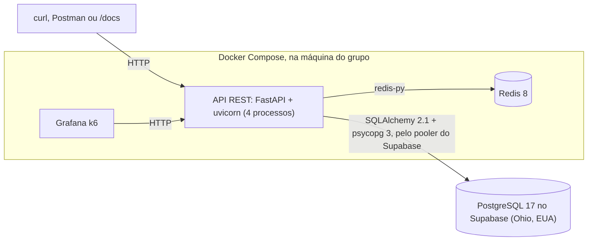
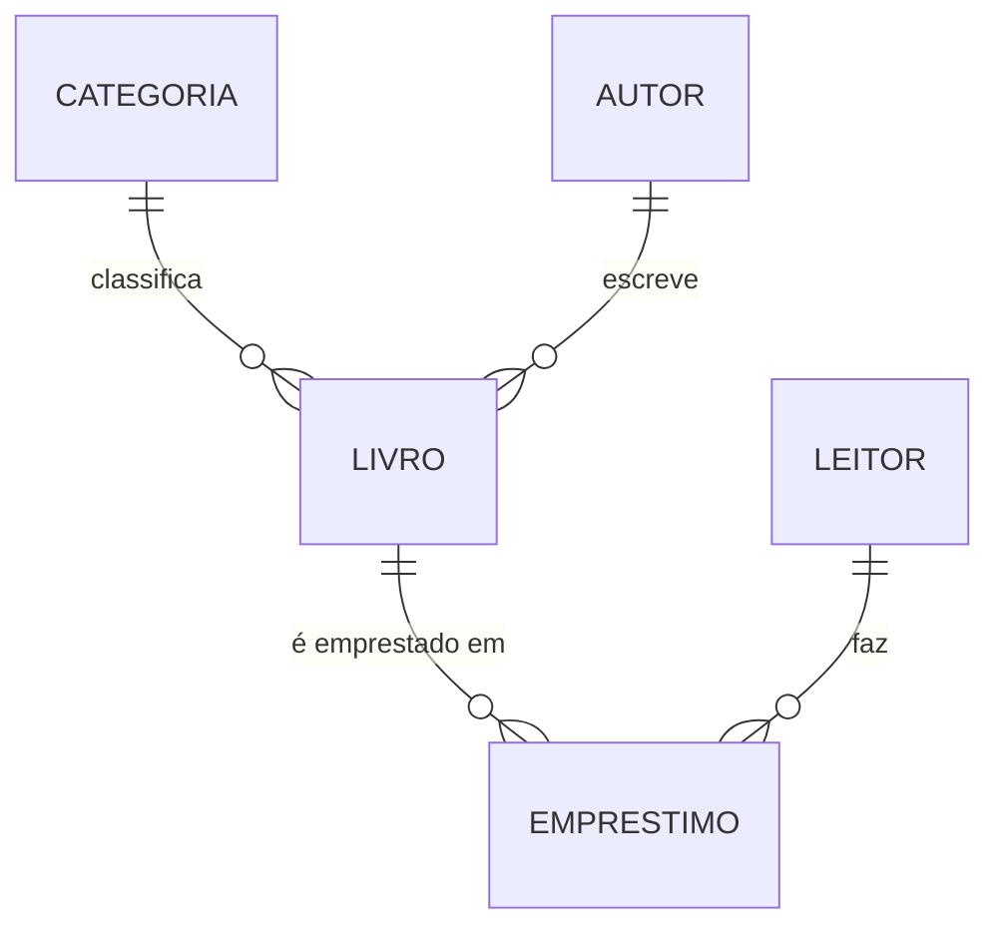

# Biblioteca: otimização de Web Services com cache, consultas ao banco e testes de carga

Trabalho Prático A2 de Análise e Otimização de Sistemas (Universidade Veiga de Almeida).

| Integrante | Matrícula |
|---|---|
| Giovanni Cardoso Avallone Belo | 1230104729 |
| Luana Cristina de Azevedo Celestino | 1230206514 |
| Marcos Felipe Ferreira Pires | 1230110993 |
| Pedro Henrique Graciliano Taka | 1230119578 |

Uma API REST de biblioteca (livros, autores, categorias, leitores e empréstimos) em que a mesma
consulta existe em versões diferentes — sem e com cache; LAZY, EAGER e otimizada; sem e com
índice — para que cada técnica seja comparada por medição. Este README é o relatório técnico
pedido na seção 7.2 do enunciado; as instruções de execução estão em [Como executar](#como-executar).

## Sumário

1. [Introdução](#1-introdução)
2. [Arquitetura e tecnologias](#2-arquitetura-e-tecnologias)
3. [Implementação de cache](#3-implementação-de-cache)
4. [Otimização das consultas](#4-otimização-das-consultas)
5. [Testes de desempenho](#5-testes-de-desempenho)
6. [Discussão](#6-discussão)
7. [Conclusão](#7-conclusão)

## 1. Introdução

A aplicação é a API de uma biblioteca: catálogo de livros (com autor e categoria), leitores e
empréstimos. O enunciado não exige interface gráfica: tudo é acessado por HTTP, e a documentação
interativa em `/docs` permite chamar cada rota pelo navegador. Para a apresentação, um painel de
demonstração em `/painel` chama as mesmas rotas e mostra em destaque os números de cada resposta.

O objetivo do trabalho é aplicar três técnicas de otimização e provar o efeito de cada uma com
medições, seguindo a ideia central do enunciado: identificar o problema, implementar uma
alternativa, medir, comparar e justificar. Por isso cada operação estudada existe em mais de uma
versão, todas devolvendo exatamente o mesmo JSON, e toda resposta da API informa quantos comandos
SQL foram executados e quanto tempo se gastou no banco. O banco é um PostgreSQL no Supabase, a
cerca de 160 ms de ida e volta da API (seção 2), e por isso cada consulta economizada pesa muito
nos resultados.

| Item do enunciado | Problema estudado | Alternativas comparadas |
|---|---|---|
| 1. Cache | a ficha do livro custa três consultas e é a leitura mais frequente | sem cache; cache Redis com TTL e invalidação |
| 2. Consultas | listar empréstimos com o livro e o leitor de cada um gera o problema N+1 | LAZY, EAGER, JOIN explícito, projeção e SQL nativo |
| 2. Índices | o histórico de um leitor percorre a tabela inteira de empréstimos | sem índice; índice simples, composto e parcial |
| 3. Testes de desempenho | os ganhos se mantêm sob carga? | todas as versões acima com 10, 50, 100 e 200 usuários virtuais (Grafana k6) |

## 2. Arquitetura e tecnologias



A API, o cache e o k6 rodam em contêineres (Docker Compose) na máquina do grupo; o k6 fica na
mesma rede da API. O banco é um projeto PostgreSQL no Supabase criado para este trabalho (plano
gratuito, instância Nano, região us-east-2, em Ohio), acessado pelo pooler de sessões do Supabase
(Supavisor). As credenciais ficam num arquivo `.env`, fora do Git ([`.env.exemplo`](.env.exemplo) é
o modelo).

| Camada | Tecnologia | Por que foi escolhida |
|---|---|---|
| Web Services | Python 3.14, FastAPI 0.163, uvicorn com 4 processos | API REST com validação e documentação interativa geradas a partir do código |
| Persistência | SQLAlchemy 2.1 (ORM) e psycopg 3.3 | o equivalente em Python do JPA/Hibernate que o enunciado recomenda (2.1): LAZY e EAGER declarados no relacionamento, além de JOIN explícito, busca em lote, projeções e SQL nativo |
| Banco de dados | PostgreSQL 17 no Supabase | banco gerenciado na nuvem, sem instalação; `EXPLAIN ANALYZE`, estatísticas por comando (`pg_stat_statements`) e índices parciais |
| Cache | Redis 8.10 | compartilhado pelos processos da API e com TTL próprio (seção 3.3) |
| Testes de carga | Grafana k6 2.3 | seção 5.1 |

Como cada processo Python executa código em um núcleo por vez, a API roda com 4 processos
(`--workers 4`), cada um com 3 conexões com o banco e até 40 requisições simultâneas.

### O banco no Supabase

Ter o banco a milhares de quilômetros da API muda o peso de cada decisão, e isso aparece em todos
os resultados:

- **Cada comando SQL custa uma viagem de ~160 ms.** A rota `/api/laboratorio/banco/ida-e-volta`
  executa `SELECT 1` em sequência na mesma conexão; a mediana foi de 159 ms (Rio de Janeiro →
  Ohio). As consultas deste trabalho, com os dados em memória, levam décimos de milissegundo no
  banco. Por isso o tempo de uma requisição é, quase todo, o número de consultas vezes 160 ms, e
  reduzir consultas vale mais que acelerar cada uma.
- **Leituras sem `BEGIN` e `COMMIT`.** Numa transação, o driver manda o `BEGIN` e o `COMMIT` em
  viagens separadas: duas viagens a mais por requisição. As rotas de leitura usam uma sessão em
  modo *autocommit* (`SessaoLeitura`, em [`api/app/banco.py`](api/app/banco.py)), em que só os
  comandos da requisição vão ao banco; as escritas continuam em transação.
- **15 conexões.** O pooler aceita até 15 conexões simultâneas por usuário, o padrão para a
  instância Nano. A API usa 12 (4 processos × 3), e sobram 3 para o `psql` dos experimentos. Cada
  processo atende até 40 requisições ao mesmo tempo: as que precisam do banco esperam uma conexão
  livre, e as que não precisam (acertos no cache) não entram nessa fila.
- **A instância.** PostgreSQL 17.12, `shared_buffers` de 224 MB (as tabelas da biblioteca, com
  165 MB, cabem inteiras), `random_page_cost` de 1,1 (o padrão do PostgreSQL é 4; seção 4.5) e
  `max_connections` de 60. A conexão direta do Supabase só aceita IPv6, que os contêineres do
  Docker Desktop não alcançam; por isso a API passa pelo pooler, que aceita IPv4.
- **O que não dá para medir.** A CPU e a memória do servidor do banco não são acessíveis a quem usa
  o banco. O comportamento dele foi medido pelo `pg_stat_statements`: execuções, tempo de execução,
  linhas e blocos lidos por comando.
- **A API pública do Supabase.** O Supabase também publica o schema `public` numa API REST
  automática (Data API), que qualquer um com a chave pública do projeto pode chamar. As tabelas
  têm RLS (*row level security*) ligado e nenhuma política, então essa API não lê nem altera nada.

### Entidades e volume de dados



| Tabela | Registros | Colunas | Conteúdo |
|---|---:|---:|---|
| `categoria` | 20 | 2 | gêneros (romance, ficção científica, história...) |
| `autor` | 5.000 | 9 | nome, nacionalidade, biografia, nascimento, cidade natal, prêmios |
| `livro` | 20.000 | 79 | título, ISBN, editora, ano, páginas, sinopse e exemplares; a ficha catalográfica (subtítulo, edição, idioma, tradutor, formato, dimensões, CDD, assuntos, sumário, notas, título original, série, DOI, OCLC, palavras-chave, resumo em inglês, o registro MARC 21 e uma resenha) e os dados do acervo (localização, conservação, aquisição, preço, fornecedor, tombo, conferência, reservas, avaliações) |
| `leitor` | 10.000 | 60 | nome, e-mail e o cadastro completo (carteirinha, nascimento, tipo, curso, endereço, situação, limite, multas, preferências), os documentos (CPF, RG), os contatos (telefones, contato de emergência), a conta (senha cifrada, sessão, aceite dos termos) e o programa de fidelidade |
| `emprestimo` (entidade principal) | 300.000 | 39 | livro, leitor, datas do empréstimo, prazo e devolução, canal, atendente, renovações, multa e avaliação; o protocolo, a unidade e o terminal do atendimento, o exemplar e o estado dele na retirada e na devolução, os lembretes enviados, o pagamento da multa, a finalidade, o comentário da avaliação e a assinatura do termo de responsabilidade |

**Tabelas largas, de propósito.** Uma ficha catalográfica de verdade tem dezenas de campos, e o
cadastro de um leitor também. As tabelas foram modeladas assim para que o custo de carregar
entidades inteiras apareça: a listagem de empréstimos (seção 4) mostra só o título do livro e o
nome do leitor, mas o ORM, ao carregar um `Livro`, traz as 79 colunas (cerca de 2,4 KB por linha,
com o registro MARC e a resenha) e, ao carregar um `Leitor`, as 60 (cerca de 900 bytes). É esse
volume de dados desnecessários que as consultas otimizadas evitam. A tabela de empréstimos, com 39
colunas, tem 328 bytes por linha e 94 MB: é o que uma varredura completa lê, e o que o índice da
seção 4.5 evita. As tabelas foram alargadas em 22/11/2026 (antes, 14, 47 e 28 colunas), para as
diferenças entre as estratégias ficarem mais visíveis; todas as medições deste relatório são da
versão larga.

Os dados são gerados dentro do próprio banco por [`banco/02-dados.sql`](banco/02-dados.sql), que o
`psql` executa em cerca de 75 segundos no Supabase, com semente fixa: toda instalação tem os mesmos
registros, com as datas contadas a partir do dia da criação. São três anos de empréstimos; alguns
livros e leitores concentram mais empréstimos que outros (cada leitor tem de 10 a 243, com mediana
de 28), e os empréstimos dos últimos dias ainda estão em aberto (3.722, dos quais 901 atrasados).
As cinco tabelas, com os índices, ocupam 165 MB e cabem inteiras na memória do banco
(`shared_buffers` de 224 MB).

### Web Services

| Rota | O que faz |
|---|---|
| `GET /api/livros/{id}/sem-cache` | ficha do livro, sempre montada a partir do banco (3 consultas) |
| `GET /api/livros/{id}/com-cache` | a mesma ficha, do Redis quando possível (cabeçalho `X-Cache: HIT` ou `MISS`; com o Redis fora do ar, `INDISPONIVEL`, e a ficha vem do banco, seção 3.6) |
| `PUT /api/livros/{id}` | altera dados de catálogo e invalida a ficha no cache (`X-Cache-Invalidado: sim` ou `nao`; com o Redis fora do ar, `pendente`) |
| `GET /api/livros/{id}/disponibilidade` | exemplares disponíveis, sempre do banco |
| `GET /api/emprestimos/{estratégia}?desde_id=&quantidade=` | página de empréstimos com livro e leitor, em sete estratégias de carregamento (seção 4) |
| `GET /api/emprestimos/lazy/resumo` e `/eager/resumo` | a mesma página, sem usar livro e leitor |
| `GET /api/emprestimos/atrasados` | empréstimos atrasados, dos mais antigos aos mais recentes (busca por intervalo) |
| `POST /api/emprestimos` e `POST /api/emprestimos/{id}/devolucao` | registram empréstimo e devolução, com bloqueio da linha do livro |
| `GET /api/leitores/{id}/emprestimos` | histórico de empréstimos do leitor (consulta do experimento de índices) |
| `/api/laboratorio/...` | preparam e observam os experimentos: esvaziar ou encher o cache, encurtar o TTL de uma ficha, travar o Redis por alguns segundos, alterar um título direto no banco sem avisar o cache, criar e remover índices, `EXPLAIN ANALYZE`, SQL executado por uma operação, estatísticas dos comandos no banco, ida e volta até o banco |
| `/painel/` | painel de demonstração: uma página (HTML, CSS e JavaScript, sem dependências) com a arquitetura e o volume de dados, o experimento obrigatório da 3.4 passo a passo, a queda do Redis, LAZY × EAGER, índices, comparações em volume com as métricas da 6.4 e os resultados dos testes de carga por nível; um rodapé mostra cada chamada HTTP com os cabeçalhos de medição |

**Instrumentação.** Um ouvinte de eventos do SQLAlchemy (`before_cursor_execute` e
`after_cursor_execute`) conta cada comando SQL e o tempo dele, e um middleware escreve em toda
resposta os cabeçalhos `X-Consultas-SQL` e `Server-Timing` (tempo no banco e tempo total no
servidor, em ms). As rotas `/api/laboratorio/sql/...` executam uma operação e devolvem cada comando
SQL, na ordem, com as linhas e os bytes que voltaram do banco. É daí que saem os números das
seções 3 e 4; os roteiros que os produzem estão em [`experimentos/`](experimentos).

## 3. Implementação de cache

### 3.1 O que vai para o cache

A operação escolhida é a ficha do livro: dados de catálogo, autor, categoria, total de
empréstimos e outros livros do mesmo autor. Montá-la custa três consultas (uma com JOIN entre
livro, autor e categoria, uma contagem na tabela de empréstimos e uma busca por autor), cerca de
480 ms com o banco no Supabase (seção 3.5), e ela é a leitura mais comum de um catálogo. A
decisão sobre cada parte da ficha seguiu os critérios da 3.1 do enunciado:

| Dado | Frequência de acesso | Volatilidade | Custo de buscar no banco | Se ficar desatualizado | Decisão e invalidação |
|---|---|---|---|---|---|
| Título, autor, categoria, sinopse, editora | alta: toda consulta ao catálogo | muito baixa: só muda quando a biblioteca corrige o cadastro | 2 consultas: o livro com autor e categoria (JOIN) e os outros livros do autor | um título ou sinopse antiga por alguns minutos | cache com TTL longo; a alteração pela API apaga a ficha do cache |
| Total de empréstimos e data do último | alta (faz parte da ficha) | média: muda a cada empréstimo | 1 contagem na tabela de 300.000 empréstimos | um indicador de popularidade atrasado em minutos, sem prejuízo | vai junto com a ficha, sem invalidar a cada empréstimo; o atraso fica limitado pelo TTL |
| Exemplares disponíveis | alta | alta: muda a cada empréstimo e devolução | 1 consulta pela chave do livro | o leitor vai à estante e não encontra o livro | **fora do cache**: rota própria, sempre lida do banco |

### 3.2 As duas versões

`GET /api/livros/{id}/sem-cache` monta a ficha a partir do banco em toda requisição.
`GET /api/livros/{id}/com-cache` segue a estratégia *cache-aside* ([`api/app/rotas/livros.py`](api/app/rotas/livros.py)):

```python
def ficha_com_cache(livro_id: IdDoLivro):
    chave = cache.chave_do_livro(livro_id)           # "livro:42"
    guardada = cache.ler(chave)
    if guardada is not None:                          # acerto: nenhuma consulta ao banco
        return RespostaJSON(guardada, headers={"X-Cache": "HIT"})

    corpo = para_json(_ficha_do_banco(livro_id))      # falha: três consultas
    cache.gravar(chave, corpo)                        # SET livro:42 <json> EX 600
    return RespostaJSON(corpo, headers={"X-Cache": "MISS"})
```

O cache guarda o JSON já pronto. As duas versões usam a mesma função para montar a ficha, e a
resposta só difere no cabeçalho `X-Cache`. O campo `gerada_em` mostra quando a ficha foi montada:
se ele se repete, a resposta veio do cache.

### 3.3 Tecnologia: Redis

O Redis é um armazenamento chave-valor em memória que roda como um serviço à parte. Ele foi
escolhido, e não um cache dentro da aplicação (como o `functools.lru_cache` ou o `cachetools`
do Python), porque a API roda em 4 processos. Um cache interno teria quatro cópias
independentes; uma alteração invalidaria só a cópia do processo que a recebeu, e os outros três
continuariam servindo a ficha antiga. No Redis há uma cópia só, e apagar a chave vale para todos os
processos (e para quantos servidores houver). Ele também tem TTL nativo (`SET ... EX`) e, com
`maxmemory 256mb` e `allkeys-lru`, descarta as chaves menos usadas se a memória acabar; as 20.000
fichas ocupam 25 MB (cerca de 1,3 KB cada). O custo é uma ida e volta pela rede a cada leitura e mais um
serviço para operar. Aqui o Redis roda na mesma máquina da API: a ida e volta até ele leva menos de
1 ms, contra ~160 ms até o banco no Supabase.

### 3.4 Tempo de vida e invalidação

- **TTL de 600 segundos** (`CACHE_TTL_SEGUNDOS`). Como toda alteração feita pela API já apaga a
  ficha, o TTL só limita dois atrasos: o do total de empréstimos, que nenhuma rota invalida, e o de
  alterações feitas por fora da API (uma importação, um comando SQL direto no banco). Dez minutos
  são aceitáveis para dados de catálogo e mantêm a ficha no cache durante uma sessão inteira de
  navegação. O efeito de outros valores de TTL foi medido na seção 5.
- **Invalidação**: `PUT /api/livros/{id}` altera o livro e, depois do *commit*, apaga a chave.
  Apagar antes do *commit* abriria uma janela em que uma leitura simultânea guardaria de novo a
  versão antiga.

```python
    with Sessao.begin() as sessao:                    # transação: commit no fim do bloco
        livro = sessao.get(Livro, livro_id)
        for nome, valor in campos.items():
            setattr(livro, nome, valor)
        livro.atualizado_em = datetime.now()

    invalidou = cache.invalidar(cache.chave_do_livro(livro_id))   # DEL livro:42
```

**Experimento obrigatório** ([`experimentos/cache.py`](experimentos/cache.py)), com o TTL
reduzido para 20 s para a espera do passo 5 caber na demonstração:

| Passo | Operação | X-Cache | Consultas SQL | Tempo no servidor | Título devolvido | Ficha gerada às |
|---|---|---|---:|---:|---|---|
| 1 | GET com cache, cache vazio | MISS | 3 | 445,65 ms | A Biblioteca Eterna dos Esquecidos | 17:26:11.168 |
| 2 | GET com cache de novo | HIT | 0 | 0,50 ms | A Biblioteca Eterna dos Esquecidos | 17:26:11.168 |
| 3 | `PUT /api/livros/42` com título novo | – | 5 | 1.053,45 ms | (resposta: `X-Cache-Invalidado: sim`) | – |
| 4a | GET com cache depois do PUT | MISS | 3 | 447,72 ms | ... dos Esquecidos (edição revista) | 17:26:12.675 |
| 4b | GET com cache de novo | HIT | 0 | 0,55 ms | ... dos Esquecidos (edição revista) | 17:26:12.675 |
| 5a | `UPDATE` direto no banco, por fora da API | – | – | – | – | – |
| 5b | GET com cache | HIT | 0 | 0,71 ms | ... (edição revista), **o título antigo** | 17:26:12.675 |
| 5c | GET com cache depois de o TTL acabar | MISS | 3 | 466,02 ms | ... (edição revista) [alterado direto no banco] | 17:26:42.245 |

Horários no relógio do contêiner da API (UTC). O PUT leva cerca de 1 s porque faz sete viagens ao
banco: `BEGIN`, a leitura e a alteração do livro, `COMMIT` e as três consultas da ficha atualizada
que ele devolve.

O passo 2 mostra o reaproveitamento (mesma `gerada_em`, nenhuma consulta). Os passos 3 e 4 mostram
a invalidação: a primeira leitura depois da alteração já traz o título novo. O passo 5 mostra o
limite dessa estratégia: uma alteração feita por fora da API não avisa o cache, e a ficha antiga
continua sendo servida (5b) até expirar (5c). **Riscos**: durante esse intervalo o usuário vê um
dado que não existe mais; se o dado em cache fosse usado para uma decisão (por exemplo, permitir um
empréstimo), o erro seria grave. Por isso a disponibilidade ficou fora do cache e o registro de
empréstimo confere o estoque no banco, com a linha do livro bloqueada (`SELECT ... FOR UPDATE`).
Resta ainda uma janela rara de corrida: uma leitura que buscou a versão antiga antes do *commit*
pode gravá-la no cache logo depois da invalidação; o TTL também limita esse caso.

O painel (`/painel/`, seção Cache) repete os cinco passos com a API no ar e o TTL padrão, marcando
cada um quando a resposta mostra o comportamento esperado. Para o passo 5, duas rotas de
laboratório substituem o `psql` e a recriação da API: `PUT /api/laboratorio/banco/livros/{id}/titulo`
faz o `UPDATE` por fora da API, sem avisar o cache, e
`PUT /api/laboratorio/cache/livros/{id}/ttl?segundos=15` encurta o tempo de vida só daquela ficha
(`EXPIRE` no Redis), para a expiração caber na demonstração.

### 3.5 Análise de desempenho do cache

Uma requisição por vez, 300 livros sorteados ([`experimentos/resultados/cache.md`](experimentos/resultados/cache.md)):

| Situação | Consultas SQL por requisição | Tempo no servidor (mediana) | p95 | Tempo total no cliente (mediana) |
|---|---:|---:|---:|---:|
| sem cache | 3 | 478,12 ms | 490,06 ms | 478,86 ms |
| com cache, falha (ficha ainda não guardada) | 3 | 479,95 ms | 496,01 ms | 480,65 ms |
| com cache, acerto | 0 | 0,35 ms | 0,41 ms | 0,80 ms |

O acerto é mais de mil vezes mais rápido no servidor (0,35 ms contra 478 ms) e não consulta o
banco: somem as três viagens até Ohio. A falha custa praticamente o mesmo que não ter cache: ela
paga as três consultas e mais uma leitura e uma gravação no Redis, que está na mesma máquina e leva
menos de 1 ms, abaixo da variação da rede até o banco (a falha chegou a sair 8 ms mais rápida, o
que é ruído).

Sob carga (seção 5.3, cenário 1), com 50 VUs: sem cache, 25,4 req/s e 2.009 ms de latência média;
com o cache quente, 5.713 req/s e 8,6 ms; com o cache frio, esvaziado logo antes da medição,
30,6 req/s e 1.662 ms, com 13% de acertos. O efeito do TTL foi medido à parte, com o cache
começando vazio (seção 5.3, "Extra: efeito do TTL"): com TTL de 5 s, a taxa de acerto ficou em
torno de 6% e a vazão em 27 req/s; com 120 ou 600 s, a taxa chegou a 24% a 27% no fim do minuto
medido, e a vazão, a 32 e 33 req/s.

**Em quais situações o cache apresentou maior benefício?** Quando a mesma ficha é lida muitas vezes
antes de mudar ou expirar, e mais ainda sob carga. Sem cache, cada ficha prende uma conexão com o
banco durante três viagens (~465 ms), e a fila por conexões cresce com o número de usuários: a
latência média foi de 0,58 s com 10 VUs para 8,8 s com 200. No acerto, o banco nem é consultado, e
a API sustentou ~5.700 req/s com latência média abaixo de 35 ms em todos os níveis. O benefício
também depende de quantas leituras se repetem: num catálogo, poucos livros concentram a maior parte
das consultas, e são eles que o cache passa a atender primeiro.

**Como a volatilidade dos dados influenciou a escolha do TTL?** Os dados de catálogo quase nunca
mudam, e toda alteração feita pela API já apaga a ficha; o TTL não precisa ser curto para que uma
alteração apareça. Ele só limita o atraso do que muda sem invalidação: o total de empréstimos, que
muda a cada empréstimo, e as alterações feitas por fora da API. Por isso 600 s: o total de
empréstimos pode atrasar até dez minutos, o que não prejudica ninguém. A disponibilidade, que muda a
cada empréstimo e decide se o leitor encontra o livro na estante, não tolera atraso nenhum e ficou
fora do cache. O experimento do TTL mostra o custo de errar para o lado curto: com 5 s, a taxa de
acerto ficou em torno de 6%, e o cache quase não aliviou o banco; com 30 s, ela parou de subir
(entre 15% e 19%) assim que as fichas começaram a expirar; com 120 ou 600 s, continuou subindo até
o fim. Um TTL curto paga o custo de um dado volátil sem que o dado seja volátil.

**Quais são os riscos de utilizar informações desatualizadas?** Mostrar ao leitor um título, uma
sinopse ou um total de empréstimos que já mudaram (passo 5b do experimento da seção 3.4); tomar
uma decisão com base num dado antigo, como liberar o empréstimo de um livro sem exemplar
disponível; e, com vários processos ou servidores, cada um servir uma versão diferente, se o cache
ficasse dentro de cada processo (o motivo do Redis, seção 3.3). As defesas adotadas: invalidar a
ficha no `PUT`, depois do *commit*; o TTL como limite para o que escapa da invalidação; e os dados
que decidem alguma coisa (a disponibilidade) sempre lidos do banco, com o empréstimo conferindo o
estoque com a linha do livro bloqueada.

**O cache sempre melhorou o desempenho?** Não. Na falha, a requisição paga as três consultas e
ainda uma leitura e uma gravação no Redis: 480 ms contra 478 ms sem cache, uma requisição por vez
(a diferença é ruído). Com o cache frio, a taxa de acerto em 30 s ficou entre 9% e 14%, e o ganho
foi nenhum com 10 VUs (18 req/s nas duas versões) e de 20% com 50 VUs; os limites do k6 estouraram
do mesmo jeito. Depois de uma alteração, a leitura seguinte volta a pagar as três consultas (passo
4a da seção 3.4: 466 ms). Com um TTL curto, a ficha expira antes de ser pedida de novo (com 5 s,
cerca de 6% de acertos e 27 req/s, perto dos 25 req/s de sem cache). E, mesmo acertando sempre, o
cache não eliminou o limite, só o mudou de lugar: com o cache quente, o gargalo passou a ser a CPU
da API. O cache melhora o desempenho na medida da taxa de acerto, que depende da repetição das
leituras, do TTL e das invalidações.

### 3.6 Extra: e se o Redis cair?

O cache é um atalho: a ficha está no banco, e o Redis guarda só uma cópia. Na primeira versão da
API, porém, uma falha do Redis derrubava as rotas que o usam. Com o contêiner do Redis parado
(`docker compose stop cache`), antes e depois desta seção:

| Requisição | Antes | Agora |
|---|---|---|
| `GET /api/livros/42/com-cache` | 500, depois de 3,3 a 4,4 s | 200 com `X-Cache: INDISPONIVEL`: a ficha vem do banco (3 consultas) |
| `PUT /api/livros/42` | 500, depois de 3,3 s, **com a alteração já gravada no banco** | 200 com `X-Cache-Invalidado: pendente` |
| `GET /api/laboratorio/estado` (usado pelo painel) | 500 | 200, com `"redis": null` |
| as outras rotas de laboratório do cache | 500 | 503, com a explicação |

O PUT era o pior caso: quem chamava recebia um erro de uma alteração que tinha dado certo, e podia
repeti-la. Três mecanismos, em [`api/app/cache.py`](api/app/cache.py), fazem a API seguir sem o
Redis:

- **Tempo limite de 0,5 s** (`CACHE_TEMPO_LIMITE_S`) para conectar e para cada leitura no Redis,
  sem novas tentativas. Uma leitura no Redis leva menos de 1 ms; meio segundo só se esgota se ele
  parou de responder. Quando o tempo acaba ou a conexão falha, `ler`, `gravar` e `invalidar`
  levantam `CacheIndisponivel`, e a rota busca a ficha no banco:

  ```python
  try:
      guardada = cache.ler(chave)
  except cache.CacheIndisponivel:                   # Redis fora do ar: a ficha vem do banco
      return RespostaJSON(_ficha_do_banco(livro_id), headers={"X-Cache": "INDISPONIVEL"})
  ```

- **Uma vigia no lugar das novas tentativas.** Depois da primeira falha, o processo da API para de
  tentar o Redis nas requisições, que vão direto ao banco, e uma thread em segundo plano testa o
  Redis a cada segundo (`PING`). Isso importa porque nem toda falha é rápida: com o contêiner
  parado, o nome `cache` deixa de existir, e o DNS do Docker leva uns 3 s para responder que ele
  não existe, tempo que o limite de 0,5 s não cobre. Sem a vigia, uma requisição a cada poucos
  segundos pagaria esses 3 s.
- **Invalidação pendente.** Se o PUT não consegue apagar a ficha, a chave fica numa lista do
  processo. Quando o Redis volta, a vigia apaga as chaves pendentes e só então devolve o cache às
  requisições. Sem isso, um Redis que volta com os dados de antes (travado, e não reiniciado)
  serviria a ficha antiga até o TTL acabar.

[`experimentos/falha_do_cache.py`](experimentos/falha_do_cache.py) tira o Redis do ar de dois
jeitos: parado (`docker compose stop cache`) e travado (`docker compose pause cache`, que congela o
processo com as fichas na memória e deixa as conexões abertas, sem resposta). Os tempos abaixo
foram medidos com o banco local (perfil `banco-local`), em que uma ficha montada no banco leva uns
4 ms; com o Supabase, ela levaria os ~480 ms da seção 3.5. Os tempos de detecção da falha (o DNS e
o tempo limite) não dependem do banco. Todas as linhas estão em
[`falha_do_cache.md`](experimentos/resultados/falha_do_cache.md):

| Parte | Situação | X-Cache | Consultas SQL | Tempo no servidor | Título devolvido |
|---|---|---|---:|---:|---|
| A | Redis parado: 1ª leitura com cache | INDISPONIVEL | 3 | 3.332 ms | o original |
| A | Redis parado: as 9 leituras seguintes (mediana) | INDISPONIVEL | 3 | 4,1 ms | o original |
| A | sem cache, para comparar (mediana de 10) | – | 3 | 3,8 ms | o original |
| A | PUT com o Redis parado | `X-Cache-Invalidado: pendente` | 5 | 10,7 ms | o novo (A) |
| A | Redis de volta, 0,5 s depois do `start` | MISS, e depois HIT | 3 e 0 | 4,4 e 0,7 ms | o novo (A) |
| B | Redis travado: 1ª leitura com cache | INDISPONIVEL | 3 | 505,5 ms | o novo (A) |
| B | PUT com o Redis travado | `X-Cache-Invalidado: pendente` | 5 | 11,2 ms | o novo (B) |
| B | as 19 leituras seguintes, em 9 s (mediana) | INDISPONIVEL | 3 | 4,0 ms | o novo (B) |
| B | Redis de volta, 0,5 s depois do `unpause` | **MISS**, e depois HIT | 3 e 0 | 5,2 e 0,9 ms | **o novo (B)** |

A primeira leitura de cada processo espera a falha aparecer: 3,3 s com o contêiner parado (o DNS) e
0,5 s com o Redis travado (o tempo limite). As seguintes custam o mesmo que a versão sem cache. A
parte B é a prova da invalidação pendente: o Redis volta com a ficha antiga na memória, e a primeira
leitura é MISS com o título novo, e não HIT com o antigo.

Sob carga, com o Redis parado (k6, `VERSAO=redis-fora`, uma execução de cada, banco local;
[`testes-carga/resultados/2026-11-22_redis-fora/`](testes-carga/resultados/2026-11-22_redis-fora)):

| VUs | Sem cache | Com cache, Redis parado | Erros com o Redis parado |
|---:|---:|---:|---:|
| 10 | 1.018 req/s, média de 9,6 ms | 891 req/s, média de 11,0 ms | 0% |
| 50 | 851 req/s, 58,6 ms | 841 req/s, 59,2 ms | 0% |
| 200 | 811 req/s, 247 ms | 750 req/s, 267 ms | 0% |

Nenhuma requisição falhou, e a vazão ficou perto da versão sem cache; as diferenças, de 1% a 12%,
estão dentro da variação entre execuções da seção 5.3. Cada um dos quatro processos registrou no log
um aviso quando percebeu a falha e outro quando o Redis voltou.

**Limites.**

- Sem o Redis, o banco recebe toda a carga. Com o Supabase, a ficha volta aos ~25 req/s de sem
  cache (seção 5.3): a queda para o banco mantém a API no ar, não o desempenho.
- A volta do Redis é um cache frio, porque ele não grava nada em disco, e as primeiras leituras são
  falhas (o cenário do cache frio da seção 5.3).
- Cada processo descobre a falha sozinho, na primeira requisição que tenta o Redis depois da queda:
  ela e as que estiverem esperando o Redis no mesmo processo, naquele momento, pagam a detecção
  (3,3 s ou 0,5 s); as seguintes, não.
- A lista de invalidações pendentes fica na memória do processo que recebeu o PUT. Um processo que
  não percebeu a queda pode servir a ficha antiga por até ~1 s depois que o Redis volta, até a vigia
  do outro apagá-la. Se a API reiniciar com o Redis fora do ar, a lista se perde, e só o TTL limita
  a ficha antiga.
- O painel trava o Redis com `CLIENT PAUSE` (`POST /api/laboratorio/cache/pausar`), porque não tem
  acesso ao Docker. Nos testes, essa pausa às vezes terminou antes do tempo pedido (7,5 s de 10 s);
  por isso o roteiro congela o contêiner, que fica parado exatamente o tempo que o roteiro decide.

## 4. Otimização das consultas

### 4.1 e 4.2 LAZY e EAGER

O relacionamento estudado é Empréstimo → Livro e Empréstimo → Leitor: a listagem devolve uma
página de empréstimos com o título do livro e o nome do leitor de cada um. No SQLAlchemy, a
estratégia é declarada no relacionamento, como o `FetchType` do JPA
([`api/app/modelos.py`](api/app/modelos.py)). A tabela é mapeada duas vezes para as duas versões
existirem lado a lado:

```python
class Emprestimo(Base):                     # LAZY: busca o livro só quando o código o acessa
    __tablename__ = "emprestimo"
    ...
    livro: Mapped[Livro] = relationship(lazy="select")
    leitor: Mapped[Leitor] = relationship(lazy="select")


class EmprestimoEager(Base):                # EAGER: a mesma tabela, com o livro e o leitor
    __table__ = Emprestimo.__table__        # trazidos na mesma consulta, com JOIN
    livro: Mapped[Livro] = relationship(lazy="joined", viewonly=True)
    leitor: Mapped[Leitor] = relationship(lazy="joined", viewonly=True)
```

A rota é a mesma nas duas versões; só muda a classe consultada. O SQL abaixo foi registrado pela
rota de laboratório para uma página de 3 empréstimos (todos os comandos estão em
[`experimentos/resultados/sql/`](experimentos/resultados/sql)):

```sql
-- LAZY: 7 comandos. A página vem primeiro; cada livro e cada leitor é buscado no momento em que
-- a resposta é montada (e.livro.titulo, e.leitor.nome), intercalados, um empréstimo por vez.
-- Cada um traz a entidade inteira: as 39 colunas do empréstimo, as 79 do livro, as 60 do leitor.
SELECT emprestimo.id, emprestimo.livro_id, emprestimo.leitor_id, ... FROM emprestimo
WHERE emprestimo.id >= 150000 ORDER BY emprestimo.id LIMIT 3;
SELECT livro.id, livro.titulo, livro.isbn, ..., livro.sumario, livro.notas, ... FROM livro WHERE livro.id = 13400;
SELECT leitor.id, leitor.nome, leitor.email, ..., leitor.observacoes, ... FROM leitor WHERE leitor.id = 8581;
SELECT ... FROM livro WHERE livro.id = 3487;
SELECT ... FROM leitor WHERE leitor.id = 7635;
SELECT ... FROM livro WHERE livro.id = 10307;
SELECT ... FROM leitor WHERE leitor.id = 53;

-- EAGER: 1 comando, 178 colunas (todas as de empréstimo, livro e leitor) para usar 8 delas
SELECT emprestimo.id, ..., livro_1.id AS id_1, livro_1.titulo, ..., livro_1.sumario, ...,
       leitor_1.id AS id_2, leitor_1.nome, ..., leitor_1.atualizado_em AS atualizado_em_1
FROM emprestimo
LEFT OUTER JOIN livro AS livro_1 ON livro_1.id = emprestimo.livro_id
LEFT OUTER JOIN leitor AS leitor_1 ON leitor_1.id = emprestimo.leitor_id
WHERE emprestimo.id >= 150000 ORDER BY emprestimo.id LIMIT 3;
```

O LAZY tem o problema N+1: 1 consulta para a página e mais 2 por empréstimo (menos os livros e
leitores repetidos, que o SQLAlchemy reaproveita da sessão). No SQLAlchemy, o EAGER declarado com
`lazy="joined"` resolveu tudo numa consulta, mas **EAGER não garante uma consulta só** (4.2 do
enunciado): a mesma intenção, "carregar antes", com outra forma de busca, deu resultados bem
diferentes:

- `selectinload` (EAGER em consultas separadas): 1 consulta para a página e 1 para todos os livros
  (`WHERE id IN (...)`), mais 1 para os leitores. O SQLAlchemy divide a lista do `IN` em lotes de
  500 ids; até 500 empréstimos por página, são sempre 3 consultas.
- `immediateload` (EAGER que busca cada objeto logo após carregar a página): o mesmo N+1 do LAZY,
  só que antes de a resposta ser montada. É o comportamento do EAGER do Hibernate numa consulta
  JPQL sem `JOIN FETCH`.

### 4.3 Comparação com diferentes quantidades de registros

[`experimentos/carregamento.py`](experimentos/carregamento.py) mediu cada estratégia com páginas de
10 a 500 empréstimos, uma requisição por vez. Cada tempo é a mediana de 15 requisições; nas
estratégias com N+1, que chegam a levar dois minutos e meio por requisição, de 1 a 3:

| Consultas SQL por requisição | 10 | 50 | 100 | 200 | 500 |
|---|---:|---:|---:|---:|---:|
| LAZY | 21 | 101 | 200 | 398 | 983 |
| EAGER (`lazy="joined"`) | 1 | 1 | 1 | 1 | 1 |
| EAGER com `selectinload` | 3 | 3 | 3 | 3 | 3 |
| EAGER com `immediateload` | 21 | 101 | 200 | 398 | 983 |
| JOIN FETCH (`joinedload`) | 1 | 1 | 1 | 1 | 1 |
| otimizada (projeção) | 1 | 1 | 1 | 1 | 1 |
| SQL nativo | 1 | 1 | 1 | 1 | 1 |

| Tempo no servidor, em ms (mediana) | 10 | 50 | 100 | 200 | 500 |
|---|---:|---:|---:|---:|---:|
| LAZY | 3.303,6 | 15.863,7 | 31.916,8 | 63.505,1 | 156.557,7 |
| EAGER (`lazy="joined"`) | 164,0 | 170,9 | 178,0 | 197,6 | 244,6 |
| EAGER com `selectinload` | 477,7 | 491,1 | 510,2 | 543,5 | 619,1 |
| EAGER com `immediateload` | 3.302,3 | 15.889,1 | 31.372,9 | 63.248,4 | 155.688,2 |
| JOIN FETCH (`joinedload`) | 162,0 | 170,3 | 190,8 | 218,9 | 256,4 |
| otimizada (projeção) | 158,8 | 159,2 | 159,5 | 163,6 | 168,5 |
| SQL nativo | 157,0 | 158,1 | 159,7 | 162,8 | 165,6 |

| Volume lido do banco, em KB | 10 | 50 | 100 | 200 | 500 |
|---|---:|---:|---:|---:|---:|
| LAZY, `selectinload` e `immediateload` (entidades inteiras) | 30,8 | 153,9 | 305,6 | 610,8 | 1.515,7 |
| EAGER e JOIN FETCH (entidades inteiras, num JOIN) | 30,8 | 153,9 | 307,5 | 614,3 | 1.538,3 |
| otimizada e SQL nativo (só as 8 colunas da resposta) | 1,1 | 5,4 | 10,8 | 21,6 | 54,1 |
| resposta da API, em JSON (igual em todas) | 2,3 | 11,4 | 22,8 | 45,6 | 114,2 |

O N+1 faz o número de consultas e o tempo crescerem na proporção do tamanho da página: com 500
empréstimos, o LAZY fez 983 consultas e levou 157 s, mais de 600 vezes o EAGER (245 ms). Executar
cada consulta custa décimos de milissegundo ao banco, mas cada uma paga a viagem até ele: o tempo
no banco medido pela API foi de 160 ms por consulta, quase todo rede. Com o banco remoto, o N+1
deixa de ser um custo e vira um defeito: uma página de só 10 empréstimos já leva 3,4 s. As
estratégias de uma consulta, ao contrário, quase não sentem o tamanho da página: de 10 para 500
empréstimos, o EAGER passou de 164 para 245 ms, e a projeção, de 159 para 169 ms.

**Volume de informações e dados desnecessários.** Para a mesma resposta de 114 KB com 500
empréstimos, o banco devolveu 1.538 KB ao EAGER (500 linhas de 178 colunas, com a sinopse, o sumário, o registro
MARC e a resenha de cada livro), 1.516 KB ao LAZY (1.482 linhas, em 983 consultas) e 54 KB à versão
otimizada, 28 vezes menos que o EAGER. Com páginas grandes, esse volume já aparece no tempo: com 500
empréstimos, o EAGER levou 245 ms e a projeção, 169 ms (45% a mais); com 10, a diferença foi de 5 ms. O
custo do EAGER aparece também quando a resposta não usa os relacionamentos: nas versões "resumo",
que devolvem só os dados do empréstimo, o mapeamento EAGER continua fazendo o JOIN e trazendo todas
as colunas de livro e leitor, cerca de 10 vezes mais dados que o LAZY:

| Versão "resumo" (sem livro e leitor) | Consultas | Lido do banco | Tempo no servidor |
|---|---:|---:|---:|
| LAZY, 20 empréstimos | 1 | 6,1 KB | 160,43 ms |
| EAGER, 20 empréstimos | 1 | 61,5 KB | 166,36 ms |
| LAZY, 500 empréstimos | 1 | 151,4 KB | 181,24 ms |
| EAGER, 500 empréstimos | 1 | 1.538,3 KB | 259,78 ms |

Com 500 empréstimos, os dados que a resposta não usa custaram 79 ms a mais no servidor (260 contra
181 ms).

**Quando usar cada um.** LAZY é o padrão mais seguro: não carrega o que não é usado e funciona bem
para objetos isolados ou relacionamentos raramente acessados; o perigo é percorrer uma lista
acessando o relacionamento, que gera o N+1. EAGER compensa quando o relacionamento é usado
praticamente sempre que a entidade é lida, mas, declarado no mapeamento, ele vale para todas as
consultas, inclusive as que não precisam dos dados (as versões "resumo"). A escolha melhor é
manter o mapeamento LAZY e pedir o carregamento antecipado em cada consulta que precisa dele
(`joinedload` ou `selectinload`), como o `JOIN FETCH` do JPA. Para coleções (um-para-muitos), o
`selectinload` evita multiplicar as linhas da consulta principal, que o JOIN causaria.

### 4.4 Otimização das consultas

Partindo do LAZY original, foram implementadas três alternativas
([`api/app/rotas/emprestimos.py`](api/app/rotas/emprestimos.py)):

```python
# JOIN FETCH: o mapeamento continua LAZY, mas esta consulta pede livro e leitor com JOIN
consulta = _pagina(Emprestimo, desde_id, quantidade).options(
    joinedload(Emprestimo.livro), joinedload(Emprestimo.leitor))

# otimizada: projeção (DTO), uma consulta com JOIN que traz só as 8 colunas da resposta
consulta = (
    select(Emprestimo.id, Emprestimo.data_emprestimo, Emprestimo.data_prevista,
           Emprestimo.data_devolucao, Livro.id.label("livro_id"), Livro.titulo,
           Leitor.id.label("leitor_id"), Leitor.nome)
    .join(Livro, Livro.id == Emprestimo.livro_id)
    .join(Leitor, Leitor.id == Emprestimo.leitor_id)
    .where(Emprestimo.id >= desde_id).order_by(Emprestimo.id).limit(quantidade))

# nativa: a mesma consulta, escrita à mão
SQL_NATIVO = text("""
    SELECT e.id, e.data_emprestimo, e.data_prevista, e.data_devolucao,
           l.id AS livro_id, l.titulo, r.id AS leitor_id, r.nome
    FROM emprestimo e
    JOIN livro l ON l.id = e.livro_id
    JOIN leitor r ON r.id = e.leitor_id
    WHERE e.id >= :desde_id ORDER BY e.id LIMIT :quantidade""")
```

O `JOIN FETCH` gera o mesmo SQL do EAGER (o mesmo JOIN, com as 178 colunas) e teve praticamente o
mesmo tempo (212,5 contra 205,7 ms com 500 empréstimos), sem impor o JOIN às outras consultas. A
versão otimizada foi a mais rápida das que usam o ORM: com 500 empréstimos, 169 ms contra 245 ms
do EAGER e 157 s do LAZY. Ela lê 28 vezes menos dados (54 KB contra 1.538 KB) e não cria
entidades; com o banco longe, quase todo o resto é a própria viagem. Sob carga, a comparação está
na seção 5.

**O SQL nativo trouxe benefício real?** Não. Ele executa a mesma consulta da versão otimizada (as
duas leram 54 KB), e a diferença de tempo entre as duas ficou abaixo de 3 ms em todos os tamanhos
de página, perto da variação entre medições: o trabalho que o SQLAlchemy faz a mais para montar a
consulta e ler o resultado some perto da viagem de 160 ms. Sob carga (seção 5.3), o SQL nativo
usou um pouco menos de CPU na API (16% contra 21% de um núcleo com 50 VUs), e as diferenças de
vazão e de latência entre os dois ficaram dentro da variação entre as repetições. O ganho grande
(cerca de 930 vezes com 500 empréstimos, de 157 s para 0,17 s) veio de eliminar o N+1 e de buscar
só as colunas usadas, e o ORM faz as duas coisas. Em troca, o SQL nativo cobra na manutenção: é
texto que o ORM não confere (um nome de coluna errado só aparece quando a rota roda), não acompanha
uma mudança no mapeamento, exige converter as linhas à mão e depende do dialeto do banco (`LIMIT` e
as conversões de tipo mudam entre PostgreSQL, SQL Server e Oracle). Faz sentido usá-lo em consultas
que o ORM não expressa bem (funções de janela, CTEs recursivas, dicas específicas do banco), não
como regra.

### 4.5 Índices (seção 5 do enunciado)

A consulta escolhida é o histórico de empréstimos de um leitor, no mesmo formato do exemplo do
enunciado (filtro por chave estrangeira, JOIN e ordenação):

```sql
SELECT e.id, e.data_emprestimo, e.data_prevista, e.data_devolucao, l.id, l.titulo
FROM emprestimo e JOIN livro l ON l.id = e.livro_id
WHERE e.leitor_id = 150
ORDER BY e.data_emprestimo DESC;
```

No estado inicial, `emprestimo(leitor_id)` não tem índice (o PostgreSQL não cria índice para chave
estrangeira). O índice proposto é `CREATE INDEX idx_emprestimo_leitor_data ON emprestimo (leitor_id, data_emprestimo DESC)`.
[`experimentos/indices.py`](experimentos/indices.py) comparou cinco situações, para o leitor 150
(58 empréstimos) e para o leitor com mais empréstimos (4322, com 243). Os planos completos estão
em [`experimentos/resultados/planos/`](experimentos/resultados/planos):

| Situação | Leitor | Operações na tabela `emprestimo` | Sort | Linhas descartadas | Execução no banco |
|---|---|---|---|---:|---:|
| 1. sem índice | 150 | Parallel Seq Scan | sim | 299.942 | 35,221 ms |
| 1. sem índice | 4322 | Parallel Seq Scan | sim | 299.756 | 51,852 ms |
| 2. índice só em `leitor_id` | 150 | Index Scan | sim | 0 | 0,381 ms |
| 2. índice só em `leitor_id` | 4322 | Index Scan | sim | 0 | 1,231 ms |
| 3. índice proposto | 150 | Index Scan, já na ordem | não | 0 | 0,347 ms |
| 3. índice proposto | 4322 | Index Scan, já na ordem | não | 0 | 1,127 ms |
| 4. índice proposto, `random_page_cost` = 4 | 150 | Bitmap Index Scan + Bitmap Heap Scan | sim | 0 | 0,402 ms |
| 4. índice proposto, `random_page_cost` = 4 | 4322 | Bitmap Index Scan + Bitmap Heap Scan | sim | 0 | 1,511 ms |
| 5. índice proposto, `LIMIT 10` | 150 | Index Scan, já na ordem | não | 0 | 0,113 ms |
| 5. índice proposto, `LIMIT 10` | 4322 | Index Scan, já na ordem | não | 0 | 0,115 ms |

Execução no banco: mediana de 15 `EXPLAIN ANALYZE`, com o `random_page_cost` de 1,1 do Supabase,
exceto na situação 4. Trechos dos planos (`EXPLAIN (ANALYZE, BUFFERS)`):

```
-- 1. sem índice: lê a tabela inteira (12.004 páginas) e descarta quase tudo
Gather Merge  (cost=15253.38..15255.45 rows=18 width=60) (actual time=34.549..41.494 rows=58 loops=1)
  Workers Planned: 1
  Workers Launched: 1
  ->  Sort  (cost=14253.37..14253.41 rows=18 width=60) (actual time=26.922..26.925 rows=29 loops=2)
        Sort Key: emprestimo.data_emprestimo DESC
        ->  Nested Loop  (cost=0.29..14252.99 rows=18 width=60) (actual time=1.096..26.868 rows=29 loops=2)
              ->  Parallel Seq Scan on emprestimo  (cost=0.00..14209.88 rows=18 width=32) (actual time=1.071..26.598 rows=29 loops=2)
                    Filter: (leitor_id = 150)
                    Rows Removed by Filter: 149971
                    Buffers: shared hit=12004
              ->  Index Scan using livro_pkey on livro  (cost=0.29..2.40 rows=1 width=32) (actual time=0.007..0.007 rows=1 loops=58)
                    Index Cond: (id = emprestimo.livro_id)
Execution Time: 41.553 ms

-- 3. índice proposto: só as 58 linhas do leitor, já na ordem pedida; o Sort sumiu
Nested Loop  (cost=0.71..106.90 rows=30 width=60) (actual time=0.022..0.325 rows=58 loops=1)
  ->  Index Scan using idx_emprestimo_leitor_data on emprestimo  (cost=0.42..35.05 rows=30 width=32) (actual time=0.014..0.080 rows=58 loops=1)
        Index Cond: (leitor_id = 150)
        Buffers: shared hit=61
  ->  Index Scan using livro_pkey on livro  (cost=0.29..2.40 rows=1 width=32) (actual time=0.004..0.004 rows=1 loops=58)
        Index Cond: (id = emprestimo.livro_id)
Execution Time: 0.362 ms

-- 4. o mesmo índice com random_page_cost = 4: só acha as linhas (bitmap) e o Sort volta
Sort  (cost=358.42..358.49 rows=30 width=60) (actual time=0.373..0.378 rows=58 loops=1)
  Sort Key: emprestimo.data_emprestimo DESC
  ->  Nested Loop  (cost=4.94..357.68 rows=30 width=60) (actual time=0.037..0.350 rows=58 loops=1)
        ->  Bitmap Heap Scan on emprestimo  (cost=4.66..120.53 rows=30 width=32) (actual time=0.028..0.117 rows=58 loops=1)
              Recheck Cond: (leitor_id = 150)
              Heap Blocks: exact=58
              ->  Bitmap Index Scan on idx_emprestimo_leitor_data  (cost=0.00..4.65 rows=30 width=0) (actual time=0.014..0.015 rows=58 loops=1)
                    Index Cond: (leitor_id = 150)
        ->  Index Scan using livro_pkey on livro  (cost=0.29..7.90 rows=1 width=32) (actual time=0.003..0.003 rows=1 loops=58)
              Index Cond: (id = emprestimo.livro_id)
Execution Time: 0.418 ms
```

Na API, o histórico do leitor 150 passou de 183,8 ms para 162,7 ms no servidor. Também foi medida
a busca por intervalo (os 50 empréstimos atrasados mais antigos: `data_devolucao IS NULL AND
data_prevista < hoje ORDER BY data_prevista`): sem índice, 23,1 ms com Parallel Seq Scan; com o
índice parcial `ON emprestimo (data_prevista) WHERE data_devolucao IS NULL`, de apenas 48 KB,
0,78 ms.

**O índice foi efetivamente utilizado?** Sim: a varredura completa (Seq Scan) deu lugar ao
`Index Scan` em `idx_emprestimo_leitor_data`, e as 299.942 linhas descartadas pelo filtro caíram
para zero. O índice composto foi usado por inteiro: o banco percorre as entradas do leitor já na
ordem de `data_emprestimo DESC`, e o `Sort` sumiu do plano. O índice só em `leitor_id` acha as
mesmas linhas, mas precisa ordená-las depois. O plano também mostra outro índice que já existia,
`livro_pkey`, usado no JOIN com `livro` em todas as situações (como o enunciado alerta na 5.2).

**Houve redução no tempo de execução?** Sim, de 35,2 ms para 0,35 ms no banco, cerca de 100 vezes.
Na API, o histórico passou de 227 para 158 ms: os 69 ms economizados no banco já são 30% do tempo
da requisição, mas a viagem de ~160 ms até ele continua sendo a maior parte. O ganho grande aparece
quando o banco fica ocupado, sob carga (seção 5): sem índice, cada requisição ocupa o banco por
35 ms; com índice, por 0,3 ms.

**Quais fatores influenciaram o resultado?**

- *Seletividade*: o leitor 150 tem 58 dos 300.000 empréstimos (0,02%). Com tão poucas linhas, o
  índice vence com folga; para o leitor com 243 empréstimos, o tempo com índice subiu para 1,10 ms
  (cresce com as linhas do leitor), enquanto a varredura completa custa quase o mesmo para todos.
- *Modelo de custos do planejador*: o `random_page_cost` diz quanto custa ler uma página fora de
  ordem. O padrão do PostgreSQL é 4, pensado para disco magnético; o Supabase usa 1,1, valor
  indicado para SSD. Com 1,1, percorrer o índice na ordem pedida sai barato, e o `Sort` some. Com 4
  (situação 4), o mesmo índice só serve para achar as linhas, que são lidas na ordem física da
  tabela e ordenadas depois. O plano depende da configuração do banco, não só do índice.
- *LIMIT*: pedindo só os 10 mais recentes, o banco lê as 10 primeiras entradas do leitor e para:
  0,11 ms, seja qual for o leitor.
- *Correlação física*: os empréstimos de um leitor estão espalhados pela tabela, uma página para
  cada (58 linhas em 58 páginas, `Heap Blocks: exact=58` no plano 4), porque a tabela está em
  ordem de data e não de leitor.

**Quais podem ser os custos de manter índices adicionais?** Espaço e escrita. O índice proposto
ocupa 9,0 MB, quatro vezes o índice só em `leitor_id` (2,2 MB), que se beneficia da deduplicação
de chaves repetidas do PostgreSQL; a tabela inteira tem 94 MB (as 12.004 páginas que a varredura
completa lê). E todo `INSERT` precisa atualizar cada índice: inserir 20.000 empréstimos (numa
transação desfeita no fim; tempo de execução no banco, mediana de 5) levou 42,5 µs por linha sem
os índices do experimento, 61,2 µs com o índice proposto (+44%) e 84,6 µs com os três (+99%).
Também há mais trabalho de `VACUUM` e mais páginas disputando a memória do banco.

| Índices extras em `emprestimo` | Tamanho dos índices | Inserir 20.000 empréstimos | Por linha |
|---|---:|---:|---:|
| nenhum (só chave primária e `livro_id`) | 8,9 MB | 851 ms | 42,5 µs |
| `(leitor_id, data_emprestimo DESC)` | 17,9 MB | 1.224 ms | 61,2 µs |
| os três do experimento | 20,1 MB | 1.693 ms | 84,6 µs |

**Criar índices em todas as colunas consultadas seria uma boa estratégia?** Não. Cada índice só
ajuda as consultas que filtram ou ordenam pelas colunas dele, na ordem certa e com seletividade
suficiente; em colunas pouco seletivas (como `data_devolucao IS NULL` sem ser parcial, ou uma
categoria entre 20) o planejador prefere a varredura completa e o índice só ocupa espaço. E todos
eles encarecem cada escrita, justamente na tabela que mais recebe escritas (a de empréstimos). O
caminho é indexar as consultas que importam, conferir com `EXPLAIN ANALYZE` se o índice é usado e
preferir índices que sirvam a mais de uma consulta, ou parciais quando só uma fração das linhas
interessa, como o dos empréstimos em aberto.

## 5. Testes de desempenho

### 5.1 Ferramenta: Grafana k6

O k6 é uma ferramenta de código aberto da Grafana Labs para testes de carga. Os testes são scripts
em JavaScript ([`testes-carga/k6/`](testes-carga/k6)), versionados junto com o código, e o próprio
k6 calcula as métricas pedidas (latência média, p95, p99, vazão e taxa de erros), confere limites
de aceitação (*thresholds*) e tem um painel web com gráficos ao vivo, que também exporta um
relatório HTML. Ele foi escolhido por isso e por rodar pela linha de comando, num contêiner, sem
interface gráfica: a matriz inteira de testes roda sem intervenção.

Cada script define, com os *scenarios* do k6, os níveis de carga em sequência. Em cada nível há
10 s de aquecimento, descartados, e 30 s de medição. As métricas de cada nível saem separadas
graças às *tags* `fase` e `carga`, e os limites são conferidos nível a nível
([`testes-carga/k6/comum.js`](testes-carga/k6/comum.js)):

```js
scenarios[`aquecimento_${vus}vus`] = { executor: 'constant-vus', vus, duration: '10s',
  startTime: `${t}s`, tags: { fase: 'aquecimento', carga } };
scenarios[`medicao_${vus}vus`] = { executor: 'constant-vus', vus, duration: '30s',
  startTime: `${t + 10}s`, tags: { fase: 'medicao', carga } };

thresholds[`http_req_duration{fase:medicao,carga:${vus}}`] = ['p(95)<1000', 'p(99)<2000'];
thresholds[`http_req_failed{fase:medicao,carga:${vus}}`] = ['rate<0.01'];
```

Os limites (p95 abaixo de 1 s, p99 abaixo de 2 s e menos de 1% de erros) levam em conta a
distância do banco: sem carga nenhuma, uma ficha montada no banco já leva cerca de 0,48 s (três
consultas de ~160 ms). Eles marcam o nível de carga a partir do qual a fila pesa mais que o
trabalho. O k6 espera até 60 s por resposta; depois disso, a requisição conta como erro.

Além das métricas do k6, cada requisição registra três métricas próprias, lidas dos cabeçalhos da
API: consultas SQL por requisição, tempo no banco e acerto do cache.

### 5.2 Cenários e cargas

| Cenário | Script | Versões comparadas | Requisição |
|---|---|---|---|
| 1. Cache | `cache.js` | sem cache; cache frio (esvaziado logo antes de cada medição); cache quente (as 20.000 fichas guardadas antes do teste, de uma vez, por `POST /api/laboratorio/cache/encher`) | ficha de um livro sorteado entre 20.000, com popularidade: 1% dos livros recebe 22% das requisições, e 10% recebe 46% |
| 2. Persistência | `persistencia.js` | LAZY, EAGER, otimizada e SQL nativo | página de 20 empréstimos a partir de um id sorteado; o EAGER traz 89 colunas por linha, a otimizada 8 |
| 3. Índices | `indice.js` | sem índice; com o índice proposto | histórico de um leitor sorteado entre 10.000 |
| Extra: TTL | `cache.js` | TTL de 5, 30, 120 e 600 s, com o cache começando vazio | ficha, 50 VUs, 60 s |

**Cargas**: 10, 50, 100 e 200 usuários virtuais (VUs) simultâneos. Cada VU manda a próxima
requisição assim que recebe a resposta; o número de VUs é a concorrência, não a vazão, que é
medida (6.3 do enunciado).

**Cuidados na execução** (6.5), todos automáticos em [`testes-carga/executar.py`](testes-carga/executar.py):

- todas as versões de um cenário recebem as mesmas cargas e durações, no mesmo ambiente;
- o estado inicial é preparado pelo próprio script do k6, no `setup()`: o cache é esvaziado ou
  enchido e o índice é criado ou removido, pelas rotas de laboratório;
- antes de tudo, as tabelas são carregadas na memória do banco (`pg_prewarm`) e todos os
  endpoints são aquecidos; depois, cada nível tem 10 s de aquecimento descartados;
- antes de cada execução, o contêiner da API é recriado. Sob carga alta, o LAZY deixa requisições
  na fila da API depois que o k6 desiste delas, e a execução seguinte começaria com essa fila;
- cada execução registra o volume de dados, os índices existentes e a configuração da API, e o
  início da matriz registra a ida e volta até o banco (`ambiente.json`);
- três repetições, com a ordem das versões alternada a cada repetição;
- o k6 roda num contêiner na mesma rede da API: medido antes, o encaminhamento de portas do Docker
  Desktop para o Windows acrescentava cerca de 1 ms por requisição e limitava a vazão (4.900 req/s
  contra 6.217 req/s no mesmo endpoint com cache);
- a CPU dos contêineres locais (API, Redis e k6) e a memória da API e do Redis são lidas a cada
  segundo dos contadores do cgroup, mais exatos que o `docker stats`. O banco no Supabase não
  mostra a CPU; no lugar dela, um `psql` conectado lê a cada segundo o tempo de execução acumulado
  no `pg_stat_statements`, e os comandos de cada execução (a diferença entre o antes e o depois)
  ficam guardados;
- o banco é um projeto do Supabase criado só para este trabalho, e a carga respeita os limites do
  plano gratuito (a 6.5 do enunciado pede ambientes próprios ou autorizados);
- dois contêineres de outro projeto (`petmotion`) ficaram ligados na máquina durante as medições;
  eles aparecem no ambiente registrado, e a CPU que usaram está em `execucoes.csv` (coluna
  `cpu_outros_pct`).

### 5.3 Resultados

A matriz completa tem 39 execuções do k6: 27 dos três cenários (9 versões, 3 repetições, cada
execução com os quatro níveis de carga) e 12 do experimento do TTL. Ela rodou em 20 e 21/11/2026,
com os volumes da seção 2. Cada número abaixo é a média das três repetições. Tudo o que foi medido
está em [`testes-carga/resultados/2026-11-20_21h56/`](testes-carga/resultados/2026-11-20_21h56):
o resumo gerado pelo `analisar.py` ([`resumo.md`](testes-carga/resultados/2026-11-20_21h56/resumo.md)),
uma linha por nível de carga de cada execução (`execucoes.csv`), os relatórios HTML do painel do k6
(`html/`), os comandos SQL de cada execução segundo o `pg_stat_statements` (`banco/`) e o ambiente
(`ambiente.json`).

**Comparação das versões com 50 VUs**, a carga "média" da 6.3, no formato da tabela da 6.6:

| Cenário | Versão | Latência média | p95 | p99 | Vazão | Erros | Consultas SQL por requisição |
|---|---|---:|---:|---:|---:|---:|---:|
| 1. Cache | sem cache | 2.009 ms | 2.888 ms | 5.433 ms | 25,4 req/s | 0% | 3 |
| 1. Cache | cache frio | 1.662 ms | 3.611 ms | 3.638 ms | 30,6 req/s | 0% | 2,6 |
| 1. Cache | cache quente | 8,6 ms | 18,5 ms | 28,9 ms | 5.713 req/s | 0% | 0 |
| 2. Persistência | LAZY | 22.453 ms¹ | 29.729 ms¹ | 30.050 ms¹ | 0,8 req/s | 0% | 41 |
| 2. Persistência | EAGER | 674 ms | 808 ms | 1.217 ms | 75,0 req/s | 0% | 1 |
| 2. Persistência | otimizada (projeção) | 659 ms | 922 ms | 1.140 ms | 76,8 req/s | 0% | 1 |
| 2. Persistência | SQL nativo | 725 ms | 1.115 ms | 1.309 ms | 71,1 req/s | 0% | 1 |
| 3. Índices | sem índice | 1.059 ms | 2.220 ms | 2.479 ms | 48,5 req/s | 0% | 1 |
| 3. Índices | com índice | 659 ms | 765 ms | 1.118 ms | 76,7 req/s | 0% | 1 |

¹ Só as requisições que terminaram dentro da janela de medição de 30 s; as outras foram
interrompidas pelo k6 no fim do nível.

Nenhuma requisição respondida falhou: a taxa de erros foi 0% em todos os níveis de todas as
execuções. Sob saturação, a API não recusa requisições, ela as enfileira, e o custo aparece na
latência.

**O teto de vazão.** Quase todos os resultados se explicam por uma conta. A API tem 12 conexões
com o banco, e cada consulta prende uma conexão durante uma viagem de ~155 ms. Uma requisição
que faz *n* consultas prende a conexão por *n* × 155 ms, e a vazão máxima é 12 ÷ (*n* × 0,155 s):
cerca de 77 req/s com uma consulta, 26 req/s com as três da ficha e menos de 2 req/s com as 41 do
LAZY. Acima desse teto, mais usuários só aumentam a fila: a vazão para de subir e a latência cresce
na proporção da carga (pela lei de Little, latência média ≈ VUs ÷ vazão; com 200 VUs e 73 req/s,
2,7 s, como medido no EAGER).

#### Cenário 1: cache

| VUs | Versão | Vazão (req/s) | Média (ms) | p95 (ms) | p99 (ms) | Erros | Acertos no cache | SQL por req. | CPU da API | Banco executando | Variação |
|---:|---|---:|---:|---:|---:|---:|---:|---:|---:|---:|---:|
| 10 | sem cache | 18 | 577 | 771 | 1.348 | 0,00% | – | 3,0 | 11% | 4% | ±18,2% |
| 10 | cache frio | 18 | 578 | 936 | 1.116 | 0,00% | 9% | 2,7 | 12% | 6% | ±11,3% |
| 10 | cache quente | 4.626 | 2,12 | 4,51 | 6,79 | 0,00% | 100% | 0,0 | 260% | 0% | ±27,7% |
| 50 | sem cache | 25 | 2.009 | 2.888 | 5.433 | 0,00% | – | 3,0 | 14% | 2% | ±1,5% |
| 50 | cache frio | 31 | 1.662 | 3.611 | 3.638 | 0,00% | 13% | 2,6 | 15% | 3% | ±1,7% |
| 50 | cache quente | 5.713 | 8,60 | 18,5 | 28,9 | 0,00% | 100% | 0,0 | 304% | 0% | ±6,1% |
| 100 | sem cache | 24 | 3.904 | 10.638 | 16.782 | 0,00% | – | 3,0 | 15% | 1% | ±2,3% |
| 100 | cache frio | 30 | 3.268 | 6.570 | 6.659 | 0,00% | 14% | 2,6 | 16% | 8% | ±0,4% |
| 100 | cache quente | 5.700 | 17,4 | 36,2 | 53,5 | 0,00% | 100% | 0,0 | 318% | 0% | ±8,6% |
| 200 | sem cache | 18 | 8.764 | 19.313 | 25.153 | 0,00% | – | 3,0 | 14% | 15% | ±28,3% |
| 200 | cache frio | 27 | 6.866 | 13.558 | 17.881 | 0,00% | 14% | 2,6 | 16% | 2% | ±2,6% |
| 200 | cache quente | 5.746 | 34,6 | 66,2 | 102 | 0,00% | 100% | 0,0 | 319% | 0% | ±13,0% |

CPU da API em % de um núcleo (400% = os quatro processos ocupados o tempo todo). Banco executando:
soma do tempo de execução das consultas da API no banco (`pg_stat_statements`) dividida pela
duração da medição; 100% equivale a uma consulta executando o tempo todo, e 400%, a quatro ao
mesmo tempo. Variação: maior distância entre a vazão de uma repetição e a média.


- **Sem cache**, a vazão parou em ~25 req/s a partir de 50 VUs, o teto das três consultas da
  ficha (cada requisição passou ~465 ms no banco). Dali em diante só a fila cresceu: a latência
  média foi de 0,58 s (10 VUs) a 8,8 s (200 VUs), e o p99 chegou a 25 s.
- **Cache quente**: de 4.600 a 5.750 req/s, sem nenhuma consulta ao banco. Com 50 VUs, a vazão
  foi 225 vezes a de sem cache, e a latência média, 8,6 ms contra 2.009 ms. O limite passou a ser
  a CPU da API, perto de 300% dos 400% que os quatro processos podem usar; o k6, na mesma máquina,
  usou mais ~140%. A latência ainda cresce com a carga (de 2,1 para 35 ms), agora na fila da CPU.
- **Cache frio**, esvaziado antes de cada nível: em 30 s só os livros mais procurados se repetem,
  e a taxa de acerto ficou entre 9% e 14%. O ganho foi pequeno: nenhum com 10 VUs (18 req/s nas
  duas versões) e 20% de vazão com 50 VUs (30,6 contra 25,4 req/s). Os limites do k6 estouraram a
  partir de 50 VUs, como sem cache; com o cache quente, todos os níveis ficaram dentro deles.

#### Cenário 2: estratégias de persistência

| VUs | Versão | Vazão (req/s) | Média (ms) | p95 (ms) | p99 (ms) | Erros | SQL por req. | CPU da API | Banco executando | Variação |
|---:|---|---:|---:|---:|---:|---:|---:|---:|---:|---:|
| 10 | LAZY | 0,8 | 10.714 | 19.156 | 21.092 | 0,00% | 40,9 | – | 1% | ±15,1% |
| 10 | EAGER | 45 | 230 | 320 | 381 | 0,00% | 1,0 | 19% | 8% | ±18,4% |
| 10 | otimizada | 58 | 172 | 225 | 281 | 0,00% | 1,0 | 16% | 3% | ±5,8% |
| 10 | SQL nativo | 48 | 218 | 305 | 381 | 0,00% | 1,0 | 12% | 4% | ±30,9% |
| 50 | LAZY | 0,8 | 22.453 | 29.729 | 30.050 | 0,00% | 41,0 | – | 3% | ±50,0% |
| 50 | EAGER | 75 | 674 | 808 | 1.217 | 0,00% | 1,0 | 30% | 7% | ±0,7% |
| 50 | otimizada | 77 | 659 | 922 | 1.140 | 0,00% | 1,0 | 21% | 3% | ±3,3% |
| 50 | SQL nativo | 71 | 725 | 1.115 | 1.309 | 0,00% | 1,0 | 16% | 4% | ±17,0% |
| 100 | LAZY | 0,2 | 18.353 | 27.627 | 28.617 | 0,00% | 41,0 | – | 3% | ±50,0% |
| 100 | EAGER | 74 | 1.379 | 2.802 | 4.624 | 0,00% | 1,0 | 28% | 7% | ±1,8% |
| 100 | otimizada | 77 | 1.335 | 3.476 | 5.059 | 0,00% | 1,0 | 22% | 6% | ±3,4% |
| 100 | SQL nativo | 77 | 1.320 | 3.299 | 4.928 | 0,00% | 1,0 | 18% | 4% | ±1,9% |
| 200 | LAZY | 0,0 | – | – | – | – | – | – | 2% | – |
| 200 | EAGER | 73 | 2.746 | 5.613 | 8.336 | 0,00% | 1,0 | 29% | 7% | ±1,5% |
| 200 | otimizada | 75 | 2.698 | 5.957 | 8.695 | 0,00% | 1,0 | 23% | 3% | ±3,2% |
| 200 | SQL nativo | 76 | 2.671 | 6.417 | 8.810 | 0,00% | 1,0 | 20% | 3% | ±2,3% |


- **LAZY**: 41 consultas por requisição (1 para a página e 2 por empréstimo), cada uma com sua
  viagem até o banco, ou seja, 6,4 s no banco por requisição. Com 10 VUs, 0,8 req/s e 10,7 s de
  latência média; com 50 e 100 VUs, a latência chegou ao tamanho da janela (p95 de 28 a 30 s) e a
  vazão caiu até 0,2 req/s; com 200 VUs, nenhuma requisição terminou dentro da janela, em nenhuma
  repetição. Cada requisição dura mais que o aquecimento, e as que o k6 abandona no fim de um nível
  continuam ocupando conexões na API durante o seguinte: o LAZY nunca chega a um regime estável, e
  os números dele mostram o colapso, não uma capacidade.
- **EAGER, otimizada e SQL nativo** fazem uma consulta só e bateram no mesmo teto, ~75 req/s a
  partir de 50 VUs, com latências praticamente iguais em cada nível. Com 10 VUs, a diferença entre
  elas (de 172 a 230 ms de média) é menor que a variação entre as repetições de uma mesma versão
  (de 159 a 263 ms no SQL nativo): ela depende de como as conexões dos VUs se distribuíram entre
  os quatro processos da API, cada um com três conexões com o banco.
- **O custo das 89 colunas** aparece nos recursos, não na latência. Com a mesma vazão, o EAGER
  ocupou mais a CPU da API (30% de um núcleo com 50 VUs, contra 21% da projeção e 16% do SQL
  nativo) e o banco: segundo o `pg_stat_statements`, cada consulta do EAGER levou 1,7 ms de
  execução, contra 0,6 ms da projeção e 0,8 ms do SQL nativo, lendo as mesmas 20 linhas e os mesmos
  127 blocos. A diferença é montar e enviar 89 colunas, com a sinopse e o sumário de cada livro, em
  vez de 8, e, na API, transformá-las em objetos. Com o banco a 155 ms, esse milissegundo some na
  viagem; com páginas maiores ou um banco próximo, ele vira tempo de resposta (seção 4.3: com 500
  empréstimos, 685 KB contra 54 KB lidos do banco e 206 contra 167 ms), e a mesma CPU atenderia
  menos requisições.

#### Cenário 3: índices

| VUs | Versão | Vazão (req/s) | Média (ms) | p95 (ms) | p99 (ms) | Erros | SQL por req. | CPU da API | Banco executando | Variação |
|---:|---|---:|---:|---:|---:|---:|---:|---:|---:|---:|
| 10 | sem índice | 35 | 321 | 439 | 669 | 0,00% | 1,0 | 12% | 211% | ±37,2% |
| 10 | com índice | 54 | 188 | 254 | 302 | 0,00% | 1,0 | 16% | 5% | ±10,4% |
| 50 | sem índice | 48 | 1.059 | 2.220 | 2.479 | 0,00% | 1,0 | 16% | 374% | ±7,8% |
| 50 | com índice | 77 | 659 | 765 | 1.118 | 0,00% | 1,0 | 20% | 2% | ±2,0% |
| 100 | sem índice | 52 | 1.964 | 4.857 | 7.256 | 0,00% | 1,0 | 17% | 383% | ±1,3% |
| 100 | com índice | 66 | 1.543 | 4.922 | 7.051 | 0,00% | 1,0 | 19% | 54% | ±14,7% |
| 200 | sem índice | 49 | 4.030 | 9.367 | 13.085 | 0,00% | 1,0 | 16% | 396% | ±2,0% |
| 200 | com índice | 75 | 2.683 | 6.228 | 9.002 | 0,00% | 1,0 | 22% | 3% | ±1,5% |


- **Sem índice**, o gargalo foi o próprio banco. Cada requisição percorreu a tabela de
  empréstimos (4.487 blocos por consulta, contra 132 com o índice), e o banco executando passou de
  370% a partir de 50 VUs: em média, quase quatro varreduras ao mesmo tempo. Disputando a CPU da
  instância, cada varredura levou em média 77 ms no banco, três vezes e meia os 22 ms medidos com
  uma consulta por vez (seção 4.5), e a vazão parou em ~50 req/s.
- **Com o índice**, o banco quase não trabalha (2% a 5% na maioria dos níveis, 2,3 ms de execução
  por consulta), e a vazão subiu até o teto das conexões. Com 50 VUs: 58% mais vazão (76,7 contra
  48,5 req/s), latência média 38% menor (659 contra 1.059 ms) e p95 66% menor (765 contra 2.220 ms).
  Com uma requisição por vez, o ganho na API tinha sido de só 21 ms (seção 4.5): o índice vale mais
  justamente quando o banco está ocupado.
- Na repetição 3, com 100 VUs, o banco ficou mais lento: 27 ms de execução por consulta com o
  índice, em média, contra 0,2 ms nas outras repetições, lendo as mesmas linhas e blocos. Isso
  explica os 54% de banco executando e a variação de ±14,7% nesse nível; a instância Nano do
  Supabase tem CPU compartilhada.

#### Memória

A memória dos contêineres foi lida junto com a CPU: a maior leitura de cada janela de medição
(`memory.current` do cgroup), em MB, média das repetições. A memória do servidor do banco não é
acessível no Supabase.

| Cenário | Versão | API, 10 VUs | API, 50 VUs | API, 100 VUs | API, 200 VUs | Redis (todos os níveis) |
|---|---|---:|---:|---:|---:|---:|
| 1. Cache | sem cache | 380 | 378 | 390 | 398 | 27 a 28 |
| 1. Cache | cache frio | 372 | 383 | 394 | 401 | 28 a 30 |
| 1. Cache | cache quente | 574 | 552 | 554 | 540 | 52 a 53 |
| 2. Persistência | LAZY | – | – | – | – | 28 a 30 |
| 2. Persistência | EAGER | 372 | 390 | 401 | 411 | 27 a 30 |
| 2. Persistência | otimizada | 368 | 374 | 382 | 392 | 27 a 28 |
| 2. Persistência | SQL nativo | 368 | 369 | 382 | 380 | 27 |
| 3. Índices | sem índice | 365 | 377 | 383 | 391 | 27 |
| 3. Índices | com índice | 366 | 377 | 381 | 394 | 27 a 29 |

- A memória não foi limite em nenhum cenário. Fora do cache quente, a API ficou entre 365 e
  411 MB, menos de 7% dos 5,8 GB da máquina virtual do Docker, e cresceu no máximo 11% de 10 para
  200 VUs, com mais requisições em andamento ao mesmo tempo. O EAGER foi o que mais cresceu (de
  372 para 411 MB, contra 368 a 380 MB do SQL nativo): cada requisição em andamento mantém na
  memória objetos com as 89 colunas.
- O Redis passou de ~27 MB, vazio, para 52 MB com as 20.000 fichas: os 25 MB das fichas (seção
  3.3) são o custo de memória do cache.
- No cache quente, a API ocupou de 140 a 190 MB a mais que sem cache, desde o nível de 10 VUs, e
  a memória não cresceu com a carga. O acréscimo vem do preparo, não das requisições: para encher
  o cache, um dos processos monta as 20.000 fichas de uma vez (`POST /api/laboratorio/cache/encher`)
  e continua com essa memória. Medido à parte, com a API recém-recriada, esse processo passou de
  107 para 302 MB, e o contêiner, de 348 para 544 MB.
- No LAZY, a memória da API não foi registrada (ver as observações abaixo).

#### Extra: efeito do TTL

O cache começa vazio e a carga é de 50 VUs por 60 s, com a API recriada com cada TTL
(`CACHE_TTL_SEGUNDOS`); três repetições de cada, menos o TTL de 30 s, que ficou com duas (ver as
observações abaixo).

| TTL | Vazão (req/s) | Média (ms) | p95 (ms) | Acertos no cache (60 s) | Acertos nos últimos 20 s | Variação |
|---:|---:|---:|---:|---:|---:|---:|
| 5 s | 27 | 1.804 | 2.238 | 6% | 5% | ±10,7% |
| 30 s | 31 | 1.622 | 2.308 | 14% | 17% | ±0,1% |
| 120 s | 32 | 1.565 | 2.530 | 19% | 27% | ±5,8% |
| 600 s | 33 | 1.553 | 2.285 | 18% | 24% | ±3,5% |


- Com 5 s, a ficha quase sempre expira antes de ser pedida de novo; só os livros mais procurados
  se repetem tão rápido. A taxa de acerto ficou em torno de 6% do começo ao fim, e a vazão
  (27 req/s), perto da de sem cache (25 req/s com 50 VUs, no cenário 1).
- Com 30 s, a taxa sobe enquanto o cache se enche e para de subir a partir dos 30 s, quando as
  primeiras fichas começam a expirar: fica entre 15% e 19%.
- Com 120 e 600 s, nenhuma ficha expira dentro do minuto medido, e as duas curvas andam juntas,
  subindo até o fim (24% a 27% nos últimos 20 s). Um TTL maior que o intervalo entre duas leituras
  da mesma ficha não muda nada; abaixo disso, cada redução derruba a taxa de acerto.
- Mesmo no melhor caso, a vazão subiu pouco, de 27 para 33 req/s: com 20.000 livros e ~30 leituras
  por segundo, a maior parte das leituras de um minuto é de livros ainda não guardados. O TTL
  define o teto da taxa de acerto; quem a enche é a repetição das leituras.

**Observações sobre a execução.**

- A matriz foi executada em partes (opções `--minutos` e `--continuar` do `executar.py`). Cada
  parte recria a API, carrega as tabelas na memória do banco e mede de novo a ida e volta até ele
  (mediana entre 145 e 160 ms nas retomadas, registradas no `ambiente.json`).
- A conexão com o Supabase parou de responder algumas vezes durante a matriz, com a API inteira
  esperando o banco. Na repetição 3 do SQL nativo, a parada durou cerca de um minuto, nos níveis
  de 100 e 200 VUs: nem a API nem o `psql` que lê o `pg_stat_statements`, numa conexão à parte,
  receberam respostas, e o k6 registrou zero requisições. A execução foi refeita no fim da matriz.
  Na repetição 1 do TTL de 30 s, as leituras do Redis, segundo a segundo, mostram 18 s sem nenhuma
  requisição chegando ao cache; refeita, ela parou de novo, por 40 s, e ficou de fora: o TTL de
  30 s tem duas repetições. As mesmas leituras mostram uma parada de 9 s no fim da repetição 3 do
  TTL de 5 s, que foi mantida. Os dados descartados estão em
  [`descartadas/`](testes-carga/resultados/2026-11-20_21h56/descartadas).
- Os contêineres do outro projeto (seção 5.2) ficaram abaixo de 2% de um núcleo em quase todos os
  níveis. O maior pico foi na repetição 1 do cache quente, com 70% e 45% de um núcleo nos níveis de
  10 e 50 VUs; a vazão dessa repetição ficou dentro da faixa das outras (4.005 req/s com 10 VUs,
  entre os 3.965 e os 5.907 das repetições 3 e 2).
- No LAZY, a API é recriada logo depois de cada execução, para descartar as requisições
  abandonadas. Por isso a CPU dela acabou registrada junto com a de outros contêineres, e a memória
  não foi registrada: as duas colunas ficaram vazias. A CPU ficou em torno de 11% de um núcleo; a
  API passa o tempo esperando o banco. O roteiro foi corrigido para ler os contêineres antes de
  recriar a API.

## 6. Discussão

**Qual técnica apresentou os maiores ganhos de desempenho?** O cache, quando acerta: com 50 VUs, a
ficha passou de 25 para 5.713 req/s (225 vezes) e de 2.009 para 8,6 ms de latência média, sem
nenhuma consulta ao banco. Em seguida vem a eliminação do N+1: com 10 VUs, a página de 20
empréstimos passou de 0,8 req/s e 10,7 s de latência média (LAZY) para 45 a 58 req/s e 0,17 a
0,23 s com uma consulta só; com 500 empréstimos e uma requisição por vez, de 158 s para 0,17 s
(seção 4.3). O índice teve o menor ganho relativo, mas foi a única otimização que tirou trabalho do
próprio banco: 58% mais vazão com 50 VUs e um tempo de execução por consulta 33 vezes menor (de 77
para 2,3 ms).

**Os ganhos foram mantidos quando a carga aumentou?** Sim, e em geral cresceram, porque as versões
sem otimização saturam primeiro. Sem cache, a vazão parou em 25 req/s e a latência média foi de
0,58 s para 8,8 s entre 10 e 200 VUs; o cache quente sustentou ~5.700 req/s com latência média
abaixo de 35 ms. O LAZY entrou em colapso (com 200 VUs, nenhuma resposta dentro da janela),
enquanto as versões de uma consulta mantiveram ~75 req/s. Sem índice, o banco saturou em ~50
req/s; com ele, a API chegou ao teto das conexões. A exceção é o cache frio: o ganho dele depende
da taxa de acerto (de 9% a 14% em 30 s), não da carga.

**Houve diferenças relevantes entre latência média, p95 e p99?** Sem saturação, pouca: com 10 VUs,
o EAGER teve média de 230 ms, p95 de 320 ms e p99 de 381 ms. Saturado, a cauda se afasta muito da
média: sem cache com 100 VUs, média de 3,9 s, p95 de 10,6 s e p99 de 16,8 s; nas versões de uma
consulta com 200 VUs, média de 2,7 s e p99 de 8,3 a 8,8 s. A espera não é igual para todos: cada
VU mantém a sua conexão com um dos quatro processos da API, e cada processo tem só três conexões
com o banco; quem cai num processo com mais VUs espera mais. No cache quente a cauda continuou
curta (p99 de 102 ms com 200 VUs), porque a fila é de CPU, e não de conexões. O índice reduziu
mais a cauda que a média (com 50 VUs, p95 66% menor e média 38% menor). A média sozinha esconderia
justamente o que os usuários mais lentos sentem; por isso os limites do k6 foram definidos sobre o
p95 e o p99.

**Alguma otimização apresentou resultados inferiores aos esperados?** Sim:

- a projeção (8 colunas no lugar de 89) e o SQL nativo não ganharam do EAGER sob carga: os três
  pararam em ~75 req/s, com as mesmas latências. Eles leem quase 13 vezes menos dados, custam menos
  CPU na API e de um terço à metade do tempo de execução no banco, mas o gargalo era o número de
  conexões vezes a viagem até o banco, não o volume de dados. Com a página de 20 empréstimos do
  teste de carga, o ganho ficou nos recursos e não chegou ao usuário; no tempo de resposta, ele só
  apareceu com páginas grandes (com 500 empréstimos, 167 contra 206 ms, seção 4.3);
- o cache frio, com 9% a 14% de acertos, quase não aliviou o banco: com 10 VUs, a vazão foi a
  mesma de sem cache;
- o índice, medido com uma requisição por vez, reduziu o histórico na API de 184 para 163 ms
  (seção 4.5), muito menos que as 66 vezes medidas no banco, porque a viagem domina; o tamanho real
  do ganho só apareceu sob carga;
- o `selectinload`, um EAGER sem N+1, fez 3 consultas e ficou três vezes mais lento que o JOIN
  (485 contra 162 ms com 10 empréstimos, seção 4.3): com o banco longe, cada consulta a mais pesa.

**Quais foram os principais gargalos identificados?**

1. A ida e volta até o banco, ~155 ms por comando SQL, que domina o tempo de toda requisição que
   consulta o banco.
2. As 12 conexões com o banco, que fixam o teto de vazão em 12 ÷ (consultas × 0,155 s): 77, 26 e
   menos de 2 req/s para 1, 3 e 41 consultas por requisição.
3. A CPU do banco, quando cada consulta percorre a tabela inteira (sem índice: quase quatro
   varreduras ao mesmo tempo e ~50 req/s).
4. A CPU da API, quando o banco sai do caminho (cache quente: perto de 300% dos 400% possíveis com
   quatro processos). O k6 roda na mesma máquina e, nesse cenário, usou mais ~140% de um núcleo.

Cada otimização eliminou um gargalo e revelou o seguinte: o cache trocou a fila por conexões pela
fila de CPU da API; o índice trocou a CPU do banco pelo teto das conexões; eliminar o N+1 trocou as
41 viagens por requisição pelo mesmo teto.

**Como a redução das consultas ao banco influenciou o desempenho?** Foi o fator dominante. Com cada
comando custando uma viagem, o tempo de uma requisição é, quase todo, o número de consultas vezes
155 ms, e a vazão máxima é inversamente proporcional a ele. De 41 consultas (LAZY) para 1, a
latência média com 10 VUs caiu de 10,7 s para 0,17 a 0,23 s e o teto subiu de menos de 2 para 77
req/s; de 3 consultas para nenhuma (acerto no cache), a vazão foi de 25 para 5.700 req/s. Já
acelerar cada consulta só fez diferença quando o banco estava saturado, como no caso do índice.
Neste ambiente, reduzir viagens valeu mais que reduzir o trabalho de cada consulta.

**Quais são os possíveis custos ou riscos das otimizações adotadas?** Cada otimização troca um
custo por outro (*trade-off*): o cache troca atualidade dos dados por velocidade, a projeção troca
flexibilidade por eficiência, o SQL nativo troca portabilidade e conferência pelo ORM por
controle, e o índice troca escrita e espaço por leitura.

- *Cache*: dados desatualizados durante o TTL (seção 3.4); a invalidação precisa existir em toda
  rota que altera os dados, inclusive nas que forem criadas depois; mais um serviço para operar;
  memória (25 MB para as 20.000 fichas); e o cache frio depois de um reinício ou de uma
  invalidação em massa, quando o banco volta a receber toda a carga, como mostrou o cenário do
  cache frio. Se o Redis cair, a ficha passa a vir do banco (seção 3.6): a API continua
  respondendo, sem erros, mas com o desempenho de sem cache, e o banco precisa aguentar a carga
  inteira enquanto isso.
- *EAGER no mapeamento*: vale para todas as consultas da entidade, inclusive as que não usam os
  relacionamentos (as versões "resumo" da seção 4.3 leram 13 vezes mais dados); com coleções, o
  JOIN multiplica as linhas da consulta principal.
- *Projeções*: uma consulta e um formato de resposta por tela, e o resultado não é uma entidade:
  não dá para alterá-lo e salvá-lo pelo ORM. O *SQL nativo* ainda perde a conferência do ORM e a
  portabilidade entre bancos (seção 4.4).
- *Índices*: espaço (9 MB para o índice proposto), escrita mais cara (+14% por `INSERT` com um
  índice, +28% com três) e mais trabalho de `VACUUM`; e o plano depende da configuração do banco
  (`random_page_cost`), não só do índice.
- *Tabelas largas*: toda consulta que carrega a entidade inteira paga por todas as colunas. Quanto
  mais larga a tabela, mais importa buscar só o que a resposta usa.

**Limitações.**

- O banco fica a ~155 ms da API, numa instância compartilhada do plano gratuito. Os resultados
  valem para esse ambiente: com o banco na mesma rede, a viagem cairia para menos de 1 ms, o N+1
  continuaria sendo o pior caso, mas o volume das 89 colunas e o índice pesariam mais em relação à
  viagem. A instância também teve trechos lentos e duas paradas, que obrigaram a refazer duas
  execuções (seção 5.3).
- O k6 roda na mesma máquina que a API e disputa a CPU com ela no cenário do cache quente: a vazão
  desse cenário é um limite inferior do que a API atenderia sozinha.
- A CPU do servidor do banco não é acessível no Supabase; o comportamento dele foi medido pelo
  `pg_stat_statements`.
- Janelas de 30 s e três repetições bastam para as diferenças grandes deste trabalho, mas a
  variação entre repetições passou de 15% em alguns níveis, principalmente com 10 VUs. Diferenças
  de poucos por cento, como entre a projeção e o SQL nativo, não são conclusivas.

## 7. Conclusão

As três técnicas melhoraram o desempenho, cada uma de um jeito, e as medições mostraram por quê.
Com o banco a ~155 ms da API, o custo de uma requisição é praticamente o número de viagens até o
banco, e a capacidade da API é o número de conexões dividido pelo tempo que cada requisição as
prende. Daí os principais resultados:

- o **cache** teve o maior ganho (de 25 para 5.713 req/s com 50 VUs) porque elimina as viagens,
  mas só no acerto: com o cache frio o ganho foi pequeno, e o preço é aceitar dados desatualizados
  por até um TTL. O que vai para o cache foi decidido pela volatilidade: a ficha vai, a
  disponibilidade não;
- o **N+1** do LAZY transformou uma página de 20 empréstimos em 41 consultas e 10 s de espera, e a
  API não sustentou nem 10 usuários. Declarar EAGER ou LAZY não diz quantas consultas serão feitas:
  o `joined` fez 1, o `selectinload` 3 e o `immediateload` 41. A regra que fica é manter o
  mapeamento LAZY e pedir o carregamento antecipado em cada consulta que precisa dele;
- as **tabelas largas** mostraram o custo de carregar entidades inteiras: 89 colunas para usar 8. A
  projeção leu quase 13 vezes menos dados e gastou menos CPU na API e no banco; com páginas de 500
  empréstimos, respondeu em 167 ms contra 206 ms do EAGER. Sob carga, com páginas de 20, não
  melhorou a latência, porque o gargalo era outro. Uma otimização só chega ao usuário quando ataca
  o gargalo da vez;
- o **índice** quase não mudou uma consulta isolada, porque a viagem domina, mas sob carga tirou o
  banco da saturação: 58% mais vazão com 50 VUs. O `EXPLAIN ANALYZE` mostrou que ele é usado e
  como, e o custo de escrita mostrou por que não vale indexar todas as colunas.

**Como demonstrar, por meio de evidências, que uma mudança realmente melhorou o desempenho de um
sistema?** É a pergunta que o enunciado deixa para o fim, e a resposta deste trabalho é o próprio
método: identificar o problema, implementar uma alternativa, medir, comparar e justificar. Na
prática, foi preciso medir as versões no mesmo ambiente, com as mesmas cargas, aquecimento e
repetições; olhar os percentis, porque a média esconde a cauda; acompanhar os recursos (consultas,
CPU, memória, banco), e não só o tempo de resposta; e explicar o mecanismo por trás de cada número.
Sem isso, a projeção pareceria inútil e o índice, irrelevante; com isso, fica claro onde cada um
ajuda e qual é o próximo gargalo.

## Como executar

### Pré-requisitos

- Docker com Docker Compose (no Windows, o Docker Desktop). É o único requisito para subir a API
  e rodar os testes de carga: o k6 e o `psql` rodam em contêineres.
- Um projeto no Supabase (o plano gratuito basta), para o banco. Sem ele, dá para usar um
  PostgreSQL local, num contêiner (fim do passo 1).
- Python 3.10 ou mais novo, só para os roteiros de experimento e o roteiro dos testes de carga.
  Eles usam apenas a biblioteca padrão; não há nada para instalar com o pip.
- Opcional: o [k6](https://grafana.com/docs/k6/latest/set-up/install-k6/) instalado na máquina,
  para rodar os scripts fora do Docker.

### 1. Preparar o banco

```bash
git clone https://github.com/MarcosFelipeFP/trabalho-a2-otimizacao-web-services.git
cd trabalho-a2-otimizacao-web-services
cp .env.exemplo .env
```

No `.env`, preencha os dados do projeto no Supabase, que ficam no painel, em **Connect** >
**Session pooler**: o endereço (`PGHOST`), o usuário (`PGUSER`, no formato
`postgres.<id do projeto>`) e a senha do banco (`PGPASSWORD`). O `.env` não vai para o Git.

Depois, crie as tabelas e gere os dados (cerca de 75 segundos):

```bash
docker compose run --rm psql -f /banco/01-esquema.sql -f /banco/02-dados.sql -f /banco/03-indices.sql
```

No Git Bash do Windows, rode antes `export MSYS_NO_PATHCONV=1`, para ele não reescrever os caminhos
que começam com `/`. Para voltar ao estado inicial (dados recém-gerados, sem índices de
experimento), apague as tabelas e repita o comando acima:

```bash
docker compose run --rm psql -c "DROP TABLE emprestimo, livro, leitor, autor, categoria"
```

**Sem Supabase.** Sem o `.env`, a API usa um PostgreSQL 17 local, num contêiner do perfil
`banco-local`, que cria as tabelas e gera os dados sozinho na primeira subida:
`docker compose --profile banco-local up -d --build` (para recomeçar do zero,
`docker compose --profile banco-local down -v`). Os números deste relatório foram medidos com o
banco no Supabase; com o banco local, os tempos são bem menores, porque a ida e volta até o banco
cai de ~160 ms para menos de 1 ms.

### 2. Subir o cache e a API

```bash
docker compose up -d --build
```

A documentação interativa fica em <http://localhost:8000/docs>, onde dá para chamar todas as rotas
sem Postman, e o painel de demonstração, em <http://localhost:8000/painel/> (a raiz,
<http://localhost:8000>, leva até ele). Alguns exemplos com curl:

```bash
curl -i http://localhost:8000/api/livros/42/com-cache          # X-Cache: MISS e depois HIT
curl -i -X PUT http://localhost:8000/api/livros/42 -H "Content-Type: application/json" -d '{"titulo": "Novo título"}'
curl -i "http://localhost:8000/api/emprestimos/lazy?desde_id=1000&quantidade=20"    # X-Consultas-SQL: 41
curl -i "http://localhost:8000/api/emprestimos/eager?desde_id=1000&quantidade=20"   # X-Consultas-SQL: 1
curl "http://localhost:8000/api/laboratorio/sql/emprestimos/lazy?quantidade=3"      # o SQL executado
curl http://localhost:8000/api/leitores/150/emprestimos
curl "http://localhost:8000/api/laboratorio/explain/historico?leitor_id=150"        # EXPLAIN ANALYZE
```

As variáveis `CACHE_TTL_SEGUNDOS` (padrão 600), `CACHE_TEMPO_LIMITE_S` (quanto esperar o Redis
antes de buscar a ficha no banco, padrão 0,5), `WORKERS` (processos da API, padrão 4) e
`CONEXOES_POR_WORKER` (padrão 3) mudam a configuração: por exemplo,
`CACHE_TTL_SEGUNDOS=30 docker compose up -d api`. Com o Supabase, `WORKERS` × `CONEXOES_POR_WORKER`
deve ficar abaixo de 15, o limite do pooler, com folga para o `psql` dos roteiros.

### 3. Experimentos dos itens 1 e 2

Com a API no ar, na pasta do projeto:

```bash
python experimentos/cache.py          # experimento obrigatório do cache (3.4) e tempos com e sem cache
python experimentos/carregamento.py   # LAZY, EAGER e otimizadas com 10 a 500 empréstimos (4.3 e 4.4)
python experimentos/indices.py        # planos de execução, índices e custo de escrita (seção 5)
python experimentos/falha_do_cache.py # o Redis fora do ar: a ficha vem do banco (3.6)
```

Com o banco no Supabase, o roteiro do cache leva uns 6 minutos, o de carregamento uns 20 (cada
requisição do LAZY com 500 empréstimos leva dois minutos e meio), o de índices uns 5 e o da falha
do Redis menos de 2. O da falha do Redis para, congela e sobe de novo o contêiner do Redis. Eles
gravam tabelas em Markdown, o SQL gerado e os planos de execução em `experimentos/resultados/`. O
banco e a API voltam ao estado inicial no fim.

### 4. Testes de desempenho (k6)

Um cenário avulso, com o painel web do k6 ao vivo em <http://localhost:5665>:

```bash
docker compose run --rm --service-ports -e K6_WEB_DASHBOARD=true k6 run k6/cache.js -e VERSAO=com-cache-quente
docker compose run --rm k6 run k6/persistencia.js -e VERSAO=lazy -e CARGAS=10,50
docker compose run --rm k6 run k6/indice.js -e VERSAO=com-indice
```

A ficha com cache sob carga, com o Redis parado (seção 3.6):

```bash
docker compose stop cache
docker compose run --rm k6 run k6/cache.js -e VERSAO=redis-fora -e CARGAS=10,50,200
docker compose start cache
```

A matriz completa, com repetições, medição de CPU e memória e geração de tabelas e gráficos:

```bash
python testes-carga/executar.py            # cerca de 2 horas; deixe a máquina sem outras tarefas
python testes-carga/executar.py --rapido   # conferência do roteiro, uns 15 minutos
```

A matriz também pode rodar em partes: `--minutos 9` faz o roteiro parar antes de começar uma
execução que passaria desse tempo, e `--continuar testes-carga/resultados/<data e hora>` retoma
de onde parou, com os parâmetros da primeira parte. As tabelas e os gráficos podem ser refeitos a
qualquer momento com `python testes-carga/analisar.py testes-carga/resultados/<data e hora>`.

Os resultados ficam em `testes-carga/resultados/<data e hora>/`: `resumo.md` com as tabelas,
`graficos/`, `execucoes.csv` (uma linha por nível de carga de cada execução), o resumo de cada
execução do k6 (`k6/`), o relatório HTML do painel web do k6 da primeira repetição de cada versão
(`html/`), os comandos SQL de cada execução segundo o `pg_stat_statements` (`banco/`), a taxa de
acerto do cache segundo a segundo (`cache/`) e o ambiente da medição (`ambiente.json`).

### 5. Roteiro para a apresentação

Uma sequência de uns 7 minutos que cobre o que a 7.3 do enunciado pede, com a API no ar:

1. **Arquitetura**: o diagrama da seção 2 e `docker compose ps` (API e Redis nesta máquina; o
   banco no Supabase).
2. **Web Services**: `GET /api/livros/42/sem-cache` pela documentação interativa
   (<http://localhost:8000/docs>).
3. **Cache e atualização**: a ficha com cache duas vezes (`X-Cache: MISS` e depois `HIT`; de meio
   segundo para menos de 1 ms), um `PUT` (`X-Cache-Invalidado: sim`) e a ficha de novo, já com o
   título novo. Se sobrar tempo, a queda do Redis: no painel, "Travar o Redis por 15 s", a ficha
   com cache (`X-Cache: INDISPONIVEL`, ainda 200), um `PUT` (`X-Cache-Invalidado: pendente`) e, quando
   o Redis volta, a ficha com o título novo (MISS).
4. **LAZY e EAGER**: `X-Consultas-SQL` da página de 20 empréstimos em `/api/emprestimos/lazy` e
   `/eager` (41 contra 1) e o SQL de cada uma em `/api/laboratorio/sql/emprestimos/lazy?quantidade=3`.
5. **Consulta otimizada**: o SQL da versão `otimizada`, com 8 colunas no lugar das 89 do EAGER.
6. **Índices**: `GET /api/laboratorio/explain/historico?leitor_id=150` (Seq Scan), depois
   `PUT /api/laboratorio/indices/leitor-data` e o mesmo `EXPLAIN` (Index Scan); no fim, `DELETE`
   no mesmo endereço do índice.
7. **Teste de desempenho**: um cenário com o painel do k6 ao vivo em <http://localhost:5665>.
8. **Resultados**: as tabelas e os gráficos da seção 5.3 e a discussão.

O painel (<http://localhost:8000/painel/>) acompanha o roteiro inteiro, uma seção por passo: Visão
geral (1), Cache (3, com o experimento da 3.4 completo e a queda do Redis), LAZY × EAGER (4 e 5), Índices (6), Testes
de carga (7, com o comando para copiar e o link do painel do k6) e Resultados e conclusões (8). O
rodapé mostra cada chamada HTTP com os cabeçalhos de medição (2).

```bash
curl -s -D - -o /dev/null http://localhost:8000/api/livros/42/com-cache | grep -i -E "^(x-cache|server-timing)"
curl -s -D - -o /dev/null -X PUT http://localhost:8000/api/livros/42 -H "Content-Type: application/json" -d '{"titulo": "Novo título"}' | grep -i x-cache-invalidado
curl -s -D - -o /dev/null "http://localhost:8000/api/emprestimos/lazy?desde_id=1000&quantidade=20" | grep -i x-consultas-sql
docker compose run --rm --service-ports -e K6_WEB_DASHBOARD=true k6 run k6/cache.js -e VERSAO=com-cache-quente -e CARGAS=50
```

O `PUT` altera o livro 42 de verdade; para voltar ao estado inicial, recarregue o banco (passo 1).

## Estrutura do repositório

```
api/                  Web Services (FastAPI + SQLAlchemy)
  app/modelos.py      mapeamento das tabelas, com a versão LAZY e a EAGER do empréstimo
  app/rotas/          livros (cache), emprestimos (EAGER x LAZY), leitores (índice) e laboratório
  app/cache.py        cache das fichas no Redis, com a queda para o banco se ele falhar
  app/medicao.py      contagem de comandos SQL e tempos de cada requisição
  app/painel/         painel de demonstração (HTML, CSS e JavaScript), servido em /painel
banco/                criação das tabelas e geração dos dados (semente fixa), executadas pelo psql
  experimentos/       índices do experimento da seção 5, para execução manual
experimentos/         roteiros dos experimentos dos itens 1 e 2 e os resultados deles
testes-carga/
  k6/                 scripts do k6: cache.js, persistencia.js, indice.js e comum.js
  executar.py         roteiro que roda a matriz de testes de carga
  analisar.py         tabelas e gráficos a partir dos resultados
  graficos.py         gráficos em SVG, sem dependências externas (usado pelo analisar.py)
  resultados/         resultados da matriz usada neste relatório e da carga com o Redis parado
docker-compose.yml    cache (Redis), API, k6, psql e o PostgreSQL local opcional
.env.exemplo          modelo do .env com a conexão ao banco no Supabase
```
